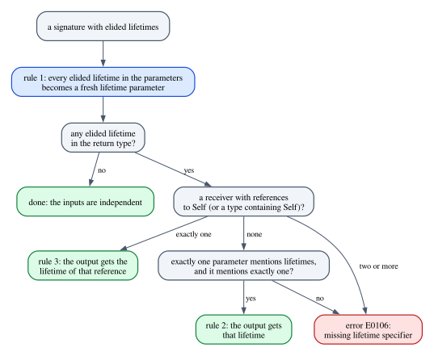

# Chapter 3 · Lifetime Elision

You have written `fn first_word(text: &str) -> &str` many times without ever
writing a lifetime in it. Yet that signature says something precise about
lifetimes: the result borrows from `text`, so it must not outlive it. The
compiler knows this because it fills in the missing lifetimes itself, following
a small set of fixed rules called *lifetime elision*. Most of the time the rules
produce exactly the contract you meant, so you never think about them. Then you
add a second reference parameter and get E0106, "missing lifetime specifier", for
a function whose body is obviously fine.

This chapter takes elision apart. We state the rules precisely, the way rustc
implements them (which is not quite how the Rust Reference words them), expand
every kind of signature by hand, and read the E0106 diagnostics label by label.
Then we ask the more interesting question: why does the compiler stop at three
rules? Why does it refuse to guess when the body makes the answer obvious? We
answer it the way this book answers everything, with programs: we invent three
plausible extra rules, apply each one by hand, and let the compiler judge the
result.

**In this chapter you will learn:**

- that elision is a fixed, syntactic rewrite of a signature that never looks at
  the body;
- the three rules as rustc 1.99 implements them, including the precise form of
  rule 2 and the `self` rule as extended in Rust 1.81;
- how to expand any elided signature: functions, methods, function pointers,
  `Fn` sugar, `impl` headers, `static` and `const` items, and associated consts;
- how to read E0106 and choose between the three honest contracts it asks for;
- why a struct field cannot elide its lifetime, and why `'static` would be a bad
  default;
- why "the first parameter", "the same lifetime everywhere" and "whatever the
  body returns" would all be worse rules than none.

## Elision is a rewrite of the signature

An *elided* lifetime is a lifetime position where you did not write a name: the
lifetime of a reference such as `&str` or `&mut Vec<u8>`, the hidden lifetime
parameter of a type such as `std::str::SplitWhitespace` when you write it
without `<'_>`, and the anonymous lifetime `'_` itself (Chapter 6). Elision is the
step in which the compiler gives each elided lifetime in a signature a meaning,
by turning it into a fresh lifetime parameter or by reusing one that is already
there. Lifetimes in the parameter types are in *input* positions; lifetimes in
the return type are in *output* positions.

The result is an ordinary signature with every lifetime named, and you can check
that it is the same contract. The program `code/examples/ch03_same_signature.rs`
writes `first_word` both ways:

```rust
// What you write:
fn first_word(text: &str) -> &str {
    text.split_whitespace().next().unwrap_or("")
}

// What the compiler reads:
fn first_word_explicit<'a>(text: &'a str) -> &'a str {
    text.split_whitespace().next().unwrap_or("")
}
```

and puts both functions into one array, which can only hold values of a single
type:

```rust
// An array holds values of a single type. Both functions coerce to the fn
// pointer type `fn(&str) -> &str`, itself elided (see "Function pointers and
// `Fn` sugar" below).
let versions: [fn(&str) -> &str; 2] = [first_word, first_word_explicit];
let line = String::from("parse the first word");
for f in versions {
    println!("{}", f(&line));
}
```

```text
parse
parse
```

Both functions coerce to the same function pointer type. The elided version is
not a weaker or "inferred" variant of the explicit one; it is the same signature,
written shorter. Three properties of this rewrite matter for everything that
follows.

- **It happens in signatures, not in bodies.** Inside a function body, a type
  annotation such as `let r: &str = ...;` also leaves a lifetime unnamed, but
  there the borrow checker *infers* it from the code, as Chapter 1 described.
  Elision is not inference: it is a fixed rule, applied to the signature alone.
- **It is syntactic.** The rules look at the lifetimes *written* in the
  signature, named or elided, and at nothing else. A lifetime hidden behind a
  type parameter `T` or behind `Self` is invisible to them, as we will see.
- **It never looks at the body.** The expanded signature is the contract. The
  body is checked against it, and every caller is checked against it without
  looking at the body. This is the thread that runs through the whole book: the
  signature is the contract.

## The three rules

Here are the rules as rustc applies them to a function signature. Rule 1 handles
the elided lifetimes in the inputs. If the return type also contains elided
lifetimes, rule 3 or rule 2 decides what they become:

1. **Inputs.** Each elided lifetime in the parameters becomes a fresh lifetime
   parameter, distinct from all the others.
2. **One input.** If exactly one parameter mentions lifetimes, and it mentions
   exactly one lifetime (elided or named, possibly several times), that lifetime
   is assigned to every elided lifetime in the output.
3. **Methods.** If the receiver contains exactly one reference to `Self` (or to a
   type that contains `Self`), as `&self` and `&mut self` do, the lifetime of that
   reference is assigned to every elided lifetime in the output, whatever the
   other parameters are.

If the output contains an elided lifetime and neither rule 2 nor rule 3 gives it
a value, elision fails with E0106, "missing lifetime specifier". Rule 3 is
checked first: when a method's receiver contains a reference to `Self`, the
other parameters are not counted at all. The figure shows the order in which
rustc takes the decisions.



The numbering follows the Rust Reference
(<https://doc.rust-lang.org/reference/lifetime-elision.html>), which states the
rules like this:

> Each elided lifetime in the parameters becomes a distinct lifetime parameter.
>
> If there is exactly one lifetime used in the parameters (elided or not), that
> lifetime is assigned to *all* elided output lifetimes.
>
> If the receiver has type `&Self` or `&mut Self`, then the lifetime of that
> reference to `Self` is assigned to all elided output lifetime parameters.

The first rule matches what rustc does. The second and the third do not quite: as
the programs below show, rustc counts *parameters* where the Reference counts
lifetimes, and rustc's `self` rule covers more receivers than `&Self` and
`&mut Self`. Where the two disagree, this book shows what rustc does.

### Rule 1: a fresh lifetime for every elided input

Rule 1 on its own never fails: any number of inputs can get any number of fresh
lifetimes. `fn f(x: &mut &str)` becomes `fn f<'a, 'b>(x: &'a mut &'b str)`: two
positions, two independent lifetimes. Independence is the right default, because
it is the most flexible contract for callers, who may then pass references of any
lifetimes at all. But it is also a promise to the callers, and the body has to
keep it. Here is a function whose body needs a relation between two of its
inputs, from `code/compile_fail/ch03_push_elided.rs`:

```rust
pub fn push(list: &mut Vec<&str>, item: &str) {
    list.push(item);
}
```

The compiler rejects it:

```text
error: lifetime may not live long enough
 --> compile_fail/ch03_push_elided.rs:7:5
  |
6 | pub fn push(list: &mut Vec<&str>, item: &str) {
  |                            -            - let's call the lifetime of this reference `'1`
  |                            |
  |                            let's call the lifetime of this reference `'2`
7 |     list.push(item);
  |     ^^^^^^^^^^^^^^^ argument requires that `'1` must outlive `'2`
  |
  = note: requirement occurs because of a mutable reference to `Vec<&str>`
  = note: mutable references are invariant over their type parameter
  = help: see <https://doc.rust-lang.org/nomicon/subtyping.html> for more information about variance
help: consider introducing a named lifetime parameter
  |
6 | pub fn push<'a>(list: &mut Vec<&'a str>, item: &'a str) {
  |            ++++                 ++              ++
```

Read the diagnostic from the top. The error has no code: "lifetime may not live
long enough" is the borrow checker's general message for a relation between two
lifetimes that the signature does not guarantee. Since both lifetimes are
anonymous, the compiler names them for the occasion: `'2` for the strings already
in the vector and `'1` for `item`. The label under `list.push(item)` states the
missing relation, "`'1` must outlive `'2`": storing `item` among the vector's
elements is only safe if `item` lives at least as long as they must. The two
notes about invariance explain why the compiler cannot simply shorten `'2` to
make things fit; that is the subject of Chapter 4. The final help proposes
exactly the contract the function needs, which is `code/examples/ch03_push_contract.rs`:

```rust
fn push<'a>(list: &mut Vec<&'a str>, item: &'a str) {
    list.push(item);
}
```

```rust
fn main() {
    let first = String::from("first");
    let second = String::from("second");
    let mut list: Vec<&str> = Vec::new();
    push(&mut list, &first);
    push(&mut list, &second); // the first `&mut list` has already ended
    println!("{} items: {list:?}", list.len());
}
```

```text
2 items: ["first", "second"]
```

Notice what the fix does *not* do: it does not give the `&mut` borrow of the
vector the name `'a`. That borrow stays elided, so it gets its own fresh lifetime,
which can be as short as the call. That is why the caller can call `push` twice
and then read `list`. Keep this program in mind; it comes back at the end of the
chapter, with a rule that names too much.

### Rule 2: exactly one parameter, exactly one lifetime

Rule 2 covers the most common signature of all, a function that takes one
reference and returns a part of it. What it counts is easy to misremember, so
here are three functions it accepts, from
`code/examples/ch03_rule2_one_parameter.rs`:

```rust
// `index` has no lifetime, so `line` is the only parameter that mentions one.
fn field(line: &str, index: usize) -> &str {
    line.split(',').nth(index).unwrap_or("").trim()
}

// The `&str` inside `fn(&str) -> bool` belongs to the fn pointer type itself,
// which elides on its own: `pred` mentions no lifetime of `first_where`.
fn first_where(line: &str, pred: fn(&str) -> bool) -> &str {
    line.split_whitespace()
        .find(|word| pred(word))
        .unwrap_or("")
}

// `S` may well be a type that borrows (`&str` below), but elision only counts
// the lifetimes that are written in the signature.
fn last_field<S: AsRef<str>>(line: &str, separator: S) -> &str {
    line.rsplit(separator.as_ref()).next().unwrap_or("")
}
```

In each function `line` is the only parameter that mentions a lifetime, and it
mentions one, so the output gets it:
`fn field<'l>(line: &'l str, index: usize) -> &'l str`. The other parameters do
not count, for three different reasons. `index` has no lifetime at all. `pred` has
a reference in its type, but that `&str` belongs to the function pointer type
`fn(&str) -> bool`, which is a small signature with its own elision (see
*Function pointers and `Fn` sugar* below); it says nothing about the lifetimes of
`first_where`. And `S` is a type parameter: the caller may choose a type that
borrows (the program passes a `&'static str`), but elision only counts what is
written in the signature, and no lifetime is written in `S`.

Rule 2 counts per *parameter*, not per reference. A single parameter can mention
two lifetimes, and then rule 2 does not apply. The classic example is a slice of
string slices; the program `code/compile_fail/ch03_rule2_slice_of_refs.rs`
returns its longest element:

```rust
pub fn longest_word(words: &[&str]) -> &str {
    words.iter().copied().max_by_key(|w| w.len()).unwrap_or("")
}
```

```text
error[E0106]: missing lifetime specifier
 --> compile_fail/ch03_rule2_slice_of_refs.rs:6:40
  |
6 | pub fn longest_word(words: &[&str]) -> &str {
  |                            -------     ^ expected named lifetime parameter
  |
  = help: this function's return type contains a borrowed value, but the signature does not say which one of `words`'s 2 lifetimes it is borrowed from
help: consider introducing a named lifetime parameter
  |
6 | pub fn longest_word<'a>(words: &'a [&'a str]) -> &'a str {
  |                    ++++         ++   ++           ++
```

The labels are precise. The dashes under `&[&str]` mark the parameter that
supplies lifetimes, the caret under the `&` of the return type marks the elided
output lifetime that received no value ("expected named lifetime parameter"),
and the help says what is missing: "which one of `words`'s 2 lifetimes it is
borrowed from". The borrow of the slice has one lifetime, the words inside it have
another, and a returned `&str` could be tied to either: to the borrow of the slice,
if it was obtained through the slice, or to the strings themselves, if it is one
of the elements copied out.

The compiler suggests naming everything `'a`. That compiles, but it is not the
best contract here. `longest_word` returns one of the elements, so the result only
needs to borrow from what the elements borrow from. The program
`code/examples/ch03_slice_of_refs.rs` says so, and gains a caller in the process:

```rust
fn longest_word<'w>(words: &[&'w str]) -> &'w str {
    words.iter().copied().max_by_key(|w| w.len()).unwrap_or("")
}

// Elided: fn longest_in<'t>(text: &'t str) -> &'t str
fn longest_in(text: &str) -> &str {
    let words: Vec<&str> = text.split_whitespace().collect();
    longest_word(&words) // borrows from `text`, not from the local vector
}
```

```text
longest
```

`longest_in` collects the words into a local vector and returns the longest. With
the compiler's suggestion instead, the result would be tied to that local vector,
and `longest_in` would no longer compile. The program
`code/compile_fail/ch03_slice_suggested.rs` shows it; E0515 means "this function
returns a reference to something it owns, which is about to be dropped", and
Chapter 5 has more on it:

```rust
pub fn longest_word<'a>(words: &'a [&'a str]) -> &'a str {
    words.iter().copied().max_by_key(|w| w.len()).unwrap_or("")
}

pub fn longest_in(text: &str) -> &str {
    let words: Vec<&str> = text.split_whitespace().collect();
    longest_word(&words)
}
```

```text
error[E0515]: cannot return value referencing local variable `words`
  --> compile_fail/ch03_slice_suggested.rs:12:5
   |
12 |     longest_word(&words)
   |     ^^^^^^^^^^^^^------^
   |     |            |
   |     |            `words` is borrowed here
   |     returns a value referencing data owned by the current function
```

A suggestion in a diagnostic is a signature that makes *this* error go away. It
is often the most restrictive one that does. Whether it is the contract you want
is a design question that only you can answer, and we will meet it again in *When
elision fails: E0106* below.

Named lifetimes count exactly like elided ones, including `'static`:

```rust
// One parameter, one lifetime written twice: rule 2 applies.
#[allow(mismatched_lifetime_syntaxes)] // the lint is discussed below
fn first_of<'a>(pair: (&'a str, &'a str)) -> &str {
    pair.0
}

// A named lifetime counts like an elided one, `'static` included: the result is
// a `&'static str`.
#[allow(mismatched_lifetime_syntaxes)]
fn static_prefix(text: &'static str, len: usize) -> &str {
    &text[..len]
}
```

The whole program prints:

```text
field 1:     "name"
first_where: "8080"
last_field:  " extra"
words:       6
first_of:    "left"
prefix:      "local"
```

`first_of` has one parameter that mentions one lifetime, twice, so rule 2 applies.
`static_prefix` has one parameter that mentions `'static`, so its output is
`'static` as well: `main` stores the result in a variable of type `&'static str`.

Here is where rustc and the Reference part ways. Two parameters that use the
*same* named lifetime (`code/compile_fail/ch03_rule2_shared_name.rs`):

```rust
pub fn first<'a>(x: &'a str, y: &'a str) -> &str {
    x
}
```

```text
error[E0106]: missing lifetime specifier
 --> compile_fail/ch03_rule2_shared_name.rs:7:45
  |
7 | pub fn first<'a>(x: &'a str, y: &'a str) -> &str {
  |                     -------     -------     ^ expected named lifetime parameter
  |
  = help: this function's return type contains a borrowed value with an elided lifetime, but the lifetime cannot be derived from the arguments
help: consider using the `'a` lifetime
  |
7 | pub fn first<'a>(x: &'a str, y: &'a str) -> &'a str {
  |                                              ++
```

The Reference's rule 2 speaks of "exactly one lifetime used in the parameters",
and this signature uses exactly one, `'a`. rustc counts the parameters that
mention lifetimes, finds two, and does not apply rule 2. (The help is worded
differently from the case of two elided inputs below, "the lifetime cannot be
derived from the arguments", but it is the same E0106.) The same happens with
`fn f(x: &'static str, y: &'static str) -> &str`: one lifetime, two parameters,
E0106.

In practice you rarely notice the difference, because every signature that rule 2
accepts with a named input lifetime and an elided output triggers a warning. The
two functions above carry `#[allow(mismatched_lifetime_syntaxes)]`; without it,
rustc warns about both: "eliding a lifetime that's named elsewhere is
confusing". The `mismatched_lifetime_syntaxes` lint, warn-by-default since Rust
1.89, fires whenever a signature refers to one lifetime in two different ways:
`'a` in an input and an elided `&str` in the output, or an elided `&str` in an
input and a type with a hidden lifetime parameter in the output, such as
`SplitWhitespace` without `<'_>` ("hiding a lifetime that's elided elsewhere is
confusing"). The fix is always to write the lifetime the same way everywhere:
`-> &'a str`, `-> &'static str`, `-> SplitWhitespace<'_>`. So once you have named
a lifetime in the inputs, name it in the output too. Chapter 6 covers this lint
and its allow-by-default relative `elided_lifetimes_in_paths` in detail.

### Rule 3: methods borrow from `self`

A method that takes `&self` and returns a reference usually returns a part of
`self`: a field, an element, a slice of a buffer. Rule 3 makes that the default,
even when other parameters have lifetimes too. From
`code/examples/ch03_self_receivers.rs`:

```rust
// Two inputs with lifetimes, but rule 3 picks `&self`:
// fn get<'s, 'k>(&'s self, key: &'k str) -> Option<&'s str>
fn get(&self, key: &str) -> Option<&str> {
    let entry = self.entries.iter().find(|(k, _)| k == key);
    entry.map(|(_, value)| value.as_str())
}
```

Rule 2 would fail here, since two parameters mention lifetimes, but rule 3 comes
first and gives the result the lifetime of `&self`. For the caller, this means
that the key can be a temporary:

```rust
let config = Config {
    name: String::from("server"),
    entries: vec![(String::from("mode"), String::from("fast"))],
};
let mode;
{
    let key = String::from("mode"); // a temporary key...
    mode = config.get(&key);
} // ...dropped here: fine, the result borrows from `config` only
println!("mode = {mode:?}");
```

```text
mode = Some("fast")
```

This default is a convention, not a deduction, and it is wrong whenever the
result really comes from another argument. A method that returns (a part of) its
argument must say so, as in `fn pick<'k>(&self, key: &'k str) -> &'k str`. The
most important case is a struct that holds a reference and returns data borrowed
from it rather than from `self`; Chapter 2 is about exactly that
(`Option<&'src str>` instead of the elided `Option<&str>`).

#### Receivers other than `&self`

A method can take `self` in other forms: `self: Box<Self>`, `self: Rc<Self>`,
`self: Pin<&mut Self>`, and references to those, such as `self: &Rc<Self>`. Since
Rust 1.81, rustc's rule 3 looks inside the receiver type for references whose
referent *contains* `Self`:

```rust
// The reference points to a type that contains `Self` (Rust 1.81 and later).
fn name_shared(self: &Rc<Self>, _requested_by: &str) -> &str {
    &self.name
}

fn name_boxed(self: &Box<Self>, _requested_by: &str) -> &str {
    &self.name
}

// The reference points directly to `Self`, inside `Pin`.
fn name_pinned(self: Pin<&mut Self>, _requested_by: &str) -> &str {
    &self.get_mut().name
}
```

`&Rc<Self>` and `&Box<Self>` are references to types that contain `Self`, and
`Pin<&mut Self>` contains a reference directly to `Self`. In all three methods the
result borrows from the receiver, not from `_requested_by`.

If the receiver contains no reference to `Self`, rule 3 does not apply, and rule 2
looks at the other parameters. A `self: Box<Self>` owns the value and has nothing
to lend:

```rust
// A receiver without a reference lends nothing, so rule 3 does not apply and
// rule 2 looks at the other parameters: the result borrows from `line`.
fn strip_name(self: Box<Self>, line: &str) -> &str {
    line.strip_prefix(self.name.as_str()).unwrap_or(line)
}
```

The rest of the program calls the four methods:

```text
shared
boxed
pinned
: ready
```

If the receiver contains *two or more* references to `Self`, rule 3 is ambiguous,
and rustc gives up rather than fall back to the other parameters
(`code/compile_fail/ch03_self_two_refs.rs`):

```rust
pub struct Config {
    name: String,
}

impl Config {
    pub fn name(self: &&Self, _caller: &str) -> &str {
        &self.name
    }
}
```

```text
error[E0106]: missing lifetime specifier
  --> compile_fail/ch03_self_two_refs.rs:11:49
   |
11 |     pub fn name(self: &&Self, _caller: &str) -> &str {
   |                       ------           ----     ^ expected named lifetime parameter
   |
   = help: this function's return type contains a borrowed value, but the signature does not say whether it is borrowed from one of `self`'s 2 lifetimes or `_caller`
help: consider introducing a named lifetime parameter
   |
11 |     pub fn name<'a>(self: &'a &'a Self, _caller: &'a str) -> &'a str {
   |                ++++        ++  ++                 ++          ++
```

The help counts the candidates for you: "one of `self`'s 2 lifetimes", one for
each `&` in `&&Self`, "or `_caller`".

> [!NOTE]
> The receiver rule changed in Rust 1.81
> (<https://github.com/rust-lang/rust/pull/117967>). Before, only a reference
> *directly* to `Self` counted, as in `&self`, `&mut self` and `Pin<&mut Self>`.
> A receiver such as `self: &Box<Self>` contributed no lifetime, so
> `fn f(self: &Box<Self>) -> &u32` was rejected, and in
> `fn e(self: &mut Box<Self>, arg: &usize) -> &usize` the result borrowed from
> `arg`; since 1.81 it borrows from `self`. Some receivers with two references,
> such as `self: &Box<&Self>`, were accepted before and are E0106 now. The
> Reference's wording still mentions only `&Self` and `&mut Self`.

#### Elision does not see through `Self`

The rules count the lifetimes that are *written*. In an `impl` block for a type
with a lifetime parameter, `self` has the type `Self`, which is `Wrapper<'a>`, but
no lifetime is written in the receiver (`code/compile_fail/ch03_self_by_value.rs`):

```rust
pub struct Wrapper<'a> {
    text: &'a str,
}

impl<'a> Wrapper<'a> {
    pub fn into_text(self) -> &str {
        self.text
    }
}
```

```text
error[E0106]: missing lifetime specifier
  --> compile_fail/ch03_self_by_value.rs:11:31
   |
11 |     pub fn into_text(self) -> &str {
   |                               ^ expected named lifetime parameter
   |
   = help: this function's return type contains a borrowed value, but there is no value for it to be borrowed from
help: consider using the `'a` lifetime
   |
11 |     pub fn into_text(self) -> &'a str {
   |                                ++
```

"There is no value for it to be borrowed from": as far as elision is concerned,
`into_text` has no input lifetime at all. The help shows the fix, and here it is
also the right contract: `into_text` consumes the wrapper and returns the text it
was holding, which stays valid for `'a`, however long the wrapper itself lived.

## You write, the compiler reads

With the three rules in hand, every signature can be expanded by hand. The table
collects the common shapes; the rows below the rule-based ones are the places
where elision works differently, each explained in its own section after the
table.

| You write | The compiler reads | Rule |
|---|---|---|
| `fn f(x: &str) -> &str` | `fn f<'a>(x: &'a str) -> &'a str` | 1, 2 |
| `fn f(x: &str, n: usize) -> &str` | `fn f<'a>(x: &'a str, n: usize) -> &'a str` | 1, 2 |
| `fn f(x: &mut &str)` | `fn f<'a, 'b>(x: &'a mut &'b str)` | 1 |
| `fn f(x: &str, y: &str) -> &str` | E0106 | none applies |
| `fn f<'a>(x: &'a str, y: &str) -> &str` | E0106 | none applies |
| `fn f(x: &[&str]) -> &str` | E0106 | none applies |
| `fn m(&self, k: &str) -> &str` | `fn m<'s, 'k>(&'s self, k: &'k str) -> &'s str` | 1, 3 |
| `fn m(self: &Rc<Self>) -> &str` | `fn m<'s>(self: &'s Rc<Self>) -> &'s str` | 1, 3 (1.81) |
| `fn f(s: &str) -> SplitWhitespace<'_>` | `fn f<'a>(s: &'a str) -> SplitWhitespace<'a>` | 1, 2 |
| `fn(&str) -> &str` | `for<'a> fn(&'a str) -> &'a str` | 1, 2 inside the type |
| `dyn Fn(&str) -> Vec<&str>` | `dyn for<'a> Fn(&'a str) -> Vec<&'a str>` | 1, 2 inside the bound |
| `impl Trait for &str` | `impl<'a> Trait for &'a str` | like 1 |
| `static S: &str` | `static S: &'static str` | `'static` |
| `const C: &[&str]` | `const C: &'static [&'static str]` | `'static` |
| `const C: &str` in an `impl` | `const C: &'static str` | `'static` (1.99) |
| `struct S { r: &str }` | E0106 | no elision |

### Function pointers and `Fn` sugar

The Reference's chapter on elision opens with "lifetime arguments can be *elided*
in function item, function pointer, and closure trait signatures". A function
pointer type such as `fn(&str) -> &str`, and the `Fn(&str) -> &str` sugar of the
closure traits, are signatures too, and the rules apply to them on their own,
inside the type. The lifetimes they produce belong to the type itself:
`fn(&str) -> &str` is `for<'a> fn(&'a str) -> &'a str`, which reads "for every
lifetime `'a`, a function from `&'a str` to `&'a str`". Such a type is called
*higher-ranked*, and Chapter 9 is about it; here the point is only where the
lifetimes come from.

Because their lifetimes are bound inside the type, these types can appear where
elision is otherwise not allowed, such as struct fields
(`code/examples/ch03_fn_types.rs`):

```rust
// Each fn type below is a small signature with its own elision:
//   fn(&str) -> &str             is  for<'a> fn(&'a str) -> &'a str
//   dyn Fn(&str) -> Vec<&str>    is  dyn for<'a> Fn(&'a str) -> Vec<&'a str>
struct Pipeline {
    normalize: fn(&str) -> &str,
    split: Box<dyn Fn(&str) -> Vec<&str>>,
}

impl Pipeline {
    fn run<'t>(&self, text: &'t str) -> Vec<&'t str> {
        (self.split)((self.normalize)(text))
    }
}
```

```text
["red", "green", "blue"]
```

`Pipeline` has no lifetime parameter and needs none: each field holds a function
that works for strings of *any* lifetime, and the explicit `'t` of `run` decides,
call by call, which lifetime the results have. (A `Box<dyn ...>` has one more
elided lifetime, the bound of the trait object itself, which follows different
defaults: here it is `'static`. Chapter 8 has the rules.)

The program `code/compile_fail/ch03_fn_pointer_two_inputs.rs` shows that elision
inside a function type fails exactly like elision in a function:

```rust
pub type Choose = fn(&str, &str) -> &str;
```

```text
error[E0106]: missing lifetime specifier
 --> compile_fail/ch03_fn_pointer_two_inputs.rs:5:37
  |
5 | pub type Choose = fn(&str, &str) -> &str;
  |                      ----  ----     ^ expected named lifetime parameter
  |
  = help: this function's return type contains a borrowed value, but the signature does not say whether it is borrowed from argument 1 or argument 2
  = note: for more information on higher-ranked polymorphism, visit https://doc.rust-lang.org/nomicon/hrtb.html
help: consider making the type lifetime-generic with a new `'a` lifetime
  |
5 | pub type Choose = for<'a> fn(&'a str, &'a str) -> &'a str;
  |                   +++++++     ++       ++          ++
help: consider introducing a named lifetime parameter
  |
5 | pub type Choose<'a> = fn(&'a str, &'a str) -> &'a str;
  |                ++++       ++       ++          ++
```

The parameters of a function type have no names, so the help speaks of "argument
1 or argument 2". The two suggestions are different contracts. With `for<'a>`, the
type stays higher-ranked: one function that works for every lifetime. With a
lifetime parameter on the type alias, `Choose<'a>` becomes a family of types, one
for each particular `'a`. Chapter 9 explains when you want which.

### `impl` headers

```rust
trait Describe {
    fn describe(&self) -> String;
}

// The compiler reads: impl<'a> Describe for &'a str
impl Describe for &str {
    fn describe(&self) -> String {
        format!("{} bytes of text", self.len())
    }
}
```

```text
18 bytes of text
```

Every elided lifetime in an `impl` header becomes a fresh lifetime parameter of
the `impl`, as in rule 1. A header has no output, so nothing can fail. The
methods inside then follow their own elision; `describe` returns a `String`, so
it has nothing to elide. For a type with a lifetime parameter, the header is
written with `'_`, as in `impl fmt::Display for Wrapper<'_>`; Chapter 6 discusses
`'_` in headers and when you need a real name instead.

### `static` and `const` items, and associated consts

An item has neither inputs nor outputs, so the three rules have nothing to work
with. Its value must stay valid for as long as the item can be used, which is the
whole program, so an elided lifetime can only mean one thing. In the words of the
Reference: "Both constant and static declarations of reference types have
*implicit* `'static` lifetimes unless an explicit lifetime is specified." From
`code/examples/ch03_static_items.rs`:

```rust
// The compiler reads: static GREETING: &'static str
static GREETING: &str = "hello";
// The compiler reads: const STOP_WORDS: &'static [&'static str]
const STOP_WORDS: &[&str] = &["a", "an", "the"];
```

Since Rust 1.99, the same holds for associated consts, the constants declared in
an `impl` block or a trait, including those in an `impl` with lifetime parameters
of its own:

```rust
struct Tokenizer<'src> {
    text: &'src str,
}

impl<'src> Tokenizer<'src> {
    // The compiler reads: const DELIMITERS: &'static [char]
    const DELIMITERS: &[char] = &[' ', ',', ';'];

    fn words(&self) -> Vec<&'src str> {
        let pieces = self.text.split(Self::DELIMITERS);
        pieces
            .filter(|w| !w.is_empty() && !STOP_WORDS.contains(w))
            .collect()
    }

    // Compiles only because DELIMITERS is `'static`, not `'src`.
    fn delimiters() -> &'static [char] {
        Self::DELIMITERS
    }
}
```

```text
hello: ["parser", "engine", "tokenizer"]
delimiters: [' ', ',', ';']
```

`delimiters` is the proof: inside `impl<'src>`, it returns `Self::DELIMITERS` as a
`&'static [char]`, which compiles only because the constant does not borrow for
`'src`.

> [!NOTE]
> Before Rust 1.99, an elided lifetime in an associated const meant `'static`
> only when no other lifetime was in scope. rustc 1.98 rejects the `DELIMITERS`
> constant above, inside `impl<'src>`, with the deny-by-default
> future-compatibility lint `elided_lifetimes_in_associated_constant`, and
> reports E0106 for `const C: &str;` in a trait that has a lifetime parameter.
> The 1.99 release notes list the change as "Infer anonymous lifetimes in the
> types of associated consts as `'static`".

## When elision fails: E0106

Now the two signatures that every Rust programmer meets sooner or later. Take
each one and apply the rules mechanically.

### Case A: two references in, one out

The first is in `code/compile_fail/ch03_two_inputs.rs`:

```rust
pub fn longer(x: &str, y: &str) -> &str {
    if x.len() >= y.len() { x } else { y }
}
```

Rule 1 gives each elided input its own lifetime. Calling them `'1` and `'2`, and
the output lifetime that we are looking for `'?` (a notation, not Rust syntax),
the signature so far is:

```rust
fn longer<'1, '2>(x: &'1 str, y: &'2 str) -> &'? str
```

There is no receiver, so rule 3 does not apply. Two parameters mention lifetimes,
so rule 2 does not apply either. Nothing gives `'?` a value, and the compiler
reports E0106:

```text
error[E0106]: missing lifetime specifier
 --> compile_fail/ch03_two_inputs.rs:6:36
  |
6 | pub fn longer(x: &str, y: &str) -> &str {
  |                  ----     ----     ^ expected named lifetime parameter
  |
  = help: this function's return type contains a borrowed value, but the signature does not say whether it is borrowed from `x` or `y`
help: consider introducing a named lifetime parameter
  |
6 | pub fn longer<'a>(x: &'a str, y: &'a str) -> &'a str {
  |              ++++     ++          ++          ++
```

Read it label by label. The dashes under the two input references mark the
candidates. The caret under the `&` of the return type marks the lifetime that has
no value: "expected named lifetime parameter". The help line asks the question
the compiler cannot answer by itself: "the signature does not say whether it is
borrowed from `x` or `y`". The suggestion below it, with `++` under each piece of
inserted text, is one possible answer, not the only one. `rustc --explain E0106`
prints a longer description of the error with more examples.

### Case B: naming one input is not enough

The second is in `code/compile_fail/ch03_named_and_elided.rs`:

```rust
pub fn first<'a>(x: &'a str, y: &str) -> &str {
    x
}
```

```text
error[E0106]: missing lifetime specifier
 --> compile_fail/ch03_named_and_elided.rs:6:42
  |
6 | pub fn first<'a>(x: &'a str, y: &str) -> &str {
  |                     -------     ----     ^ expected named lifetime parameter
  |
  = help: this function's return type contains a borrowed value, but the signature does not say whether it is borrowed from `x` or `y`
help: consider using the `'a` lifetime
  |
6 | pub fn first<'a>(x: &'a str, y: &str) -> &'a str {
  |                                           ++
```

Rule 2 counts every parameter that mentions a lifetime, named or elided, and
there are two. Naming `x` does not make it "the" input; the compiler does not
assume that the named parameter, or the elided one, is the intended source. The
help suggests `'a` for the output because `'a` is the only name available to
suggest. It is a suggestion, not an assumption: the error stands until you write
it.

### Why the compiler refuses to guess

In both cases the body leaves no doubt: `longer` returns `x` or `y`, and `first`
returns `x`. Why doesn't the compiler use that? Because the signature is the
contract that callers are checked against, and callers are checked *without*
looking at the body. If the body determined the contract, then editing the body,
say to return `y` instead of `x`, would silently change the signature that callers
in other modules and other crates rely on, and they would break without any
visible change to the API. Requiring the relationship to be written keeps the
signature authoritative: a change of contract is a change of the signature,
visible in code review and in the documentation (rustdoc shows signatures, not
bodies). The last section of this chapter tests this argument with a program.

### Three honest contracts

When elision fails, the compiler is asking you to decide what the result may
borrow from. For two string inputs there are three honest answers, which
`code/examples/ch03_three_contracts.rs` puts side by side:

```rust
// 1. The result may come from EITHER input: tie all three together.
fn longer<'a>(x: &'a str, y: &'a str) -> &'a str {
    if x.len() >= y.len() { x } else { y }
}

// 2. The result comes only from `x`: say so, and leave `y` independent.
fn first_only<'a>(x: &'a str, _y: &str) -> &'a str {
    x
}

// 3. The result borrows from neither: return an owned value.
fn joined(x: &str, y: &str) -> String {
    format!("{x}{y}")
}
```

```rust
fn main() {
    let long_lived = String::from("long-lived");
    let kept;
    {
        let short_lived = String::from("short");
        kept = first_only(&long_lived, &short_lived); // does not borrow `short_lived`
        println!("{}", longer(&long_lived, &short_lived)); // used before the `}`
        println!("{}", joined(&long_lived, &short_lived));
    }
    println!("{kept}");
}
```

```text
long-lived
long-livedshort
long-lived
```

The caller shows what each contract allows. The result of `first_only` is stored
in `kept` and outlives `short_lived`, because the contract says it does not borrow
from `y`. The result of `longer` must be used before the closing brace, because it
may borrow from either argument. The result of `joined` borrows from nothing.

| Signature | The result may borrow from | For the caller |
|---|---|---|
| `fn f<'a>(x: &'a str, y: &'a str) -> &'a str` | either input | the result must not outlive either argument |
| `fn f<'a>(x: &'a str, y: &str) -> &'a str` | only `x` | `y` may die while the result lives; the body may not return `y` |
| `fn f(x: &str, y: &str) -> String` | neither | no borrow at all |

The choice is a real design decision, not a syntax chore. The first contract is
the one the compiler suggests and the one people reach for, but it is the most
restrictive for callers; prefer the second whenever the result can only come from
one input.

## Why a struct field cannot be elided

Strip the problem to its minimum: one struct, one field, one reference. If
elision ever worked for a type definition, it would work here
(`code/compile_fail/ch03_struct_field_elided.rs`):

```rust
pub struct Holder {
    text: &str,
}
```

```text
error[E0106]: missing lifetime specifier
 --> compile_fail/ch03_struct_field_elided.rs:6:11
  |
6 |     text: &str,
  |           ^ expected named lifetime parameter
  |
help: consider introducing a named lifetime parameter
  |
5 ~ pub struct Holder<'a> {
6 ~     text: &'a str,
  |
```

The error is E0106 although there is only one reference and nothing to be
ambiguous about. The suggestion changes two lines (marked with `~`): it declares
a lifetime parameter on the struct and uses it in the field. Neither placeholder
helps (`code/compile_fail/ch03_struct_field_placeholders.rs`, which contains two
errors):

```rust
pub struct Anonymous {
    text: &'_ str,
}

pub struct Undeclared {
    text: &'a str,
}
```

```text
error[E0106]: missing lifetime specifier
 --> compile_fail/ch03_struct_field_placeholders.rs:7:12
  |
7 |     text: &'_ str,
  |            ^^ expected named lifetime parameter
  |
help: consider introducing a named lifetime parameter
  |
6 ~ pub struct Anonymous<'a> {
7 ~     text: &'a str,
  |

error[E0261]: use of undeclared lifetime name `'a`
  --> compile_fail/ch03_struct_field_placeholders.rs:11:12
   |
11 |     text: &'a str,
   |            ^^ undeclared lifetime
   |
help: consider introducing lifetime `'a` here
   |
10 | pub struct Undeclared<'a> {
   |                      ++++
```

`'_` in a field is E0106 again, and a name that was never declared is E0261, "use
of undeclared lifetime name". The reasons are structural, not a matter of missing
rules:

1. **Elision is defined for signatures.** Its rules choose the output lifetimes
   from the input lifetimes. A struct definition has no inputs and no outputs; a
   field is not a parameter, so "exactly one parameter" has nothing to count.
   That there is a single reference is irrelevant.
2. **In a struct, the lifetime is part of the type.** The fresh lifetimes of rule
   1 are local to one signature and change nothing outside it. A field's lifetime
   would have to become a parameter of the struct itself: `Holder` would secretly
   be `Holder<'x>`. Every use of the type, every `impl`, every struct that
   contains a `Holder`, and the variance of the type (Chapter 4) depend on that
   parameter, yet the declaration `struct Holder` would not show it. Rust requires
   the parameter to be written where the type is declared.
3. **The only plausible default would be `'static`, and it is a trap.** `static`
   and `const` items default to `'static` because there the answer is forced. For
   a field it would quietly restrict the type to literals and leaked data, which
   is rarely what the author of a struct with a reference wants.

The program `code/compile_fail/ch03_static_field_local.rs` shows what the third
point would cost, written out with an explicit `'static`:

```rust
pub struct Literal {
    text: &'static str,
}

pub fn caller() {
    let name = String::from("hello");
    // A borrow of a local variable is not 'static:
    let lit = Literal { text: &name };
    println!("{}", lit.text);
}
```

```text
error[E0597]: `name` does not live long enough
  --> compile_fail/ch03_static_field_local.rs:13:31
   |
11 |     let name = String::from("hello");
   |         ---- binding `name` declared here
12 |     // A borrow of a local variable is not 'static:
13 |     let lit = Literal { text: &name };
   |                               ^^^^^
   |                               |
   |                               borrowed value does not live long enough
   |                               this usage requires that `name` is borrowed for `'static`
14 |     println!("{}", lit.text);
15 | }
   | - `name` dropped here while still borrowed
```

The label "this usage requires that `name` is borrowed for `'static`" points at
the field initializer: a `&'static str` field accepts no borrow of a local
variable, however briefly the struct is used. Rust makes you choose instead, and
each choice means something different for everyone who uses the struct:

| Field | Meaning | Consequence |
|---|---|---|
| `text: &'a str` in `struct S<'a>` | borrows from some string | `S` cannot outlive that string; `'a` appears in every use of the type |
| `text: String` | owns its data | no lifetime anywhere; costs an allocation or a clone |
| `text: &'static str` | literals or leaked data only | no lifetime parameter, but only `'static` data fits |

The program `code/examples/ch03_struct_field_choices.rs` shows the three side by
side:

```rust
// 1. Borrow: the lifetime becomes a parameter of the TYPE.
struct Borrowed<'a> {
    text: &'a str,
}

// 2. Own the data: no lifetime anywhere.
struct Owned {
    text: String,
}

// 3. Literals (or leaked data) only: an explicit `'static`.
struct Literal {
    text: &'static str,
}
```

```text
hello hello literal
```

Once the parameter is declared, the *uses* of the type elide like any other
lifetime. In a signature, `Borrowed<'_>` takes part in rules 1 and 2:

```rust
// Once the parameter is declared, signatures that USE the type elide as usual:
// the compiler reads fn wrap<'a>(text: &'a str) -> Borrowed<'a>
fn wrap(text: &str) -> Borrowed<'_> {
    Borrowed { text }
}
```

You may even write `Borrowed` without `<'_>` in a signature; the hidden lifetime
is still elided, but the lint `mismatched_lifetime_syntaxes` warns that it hides
a borrow (Chapter 6). Only the *definition* must be explicit. And remember
`Pipeline` above: fields of function pointer and `dyn Fn` types are fine, because
their lifetimes are bound inside the field's own type, not by the struct.
Chapter 14 returns to the choice between borrowing and owning in a struct.

## Candidate rules that would not work

In `longer` the right answer feels obvious because *we* have read the body.
Elision may not read the body, so any extra rule would have to choose from the
signature alone. To see why that is not enough, take a function whose correct
contract is *not* the obvious one, and test the three most natural candidate
rules on it. These rules are hypothetical: Rust has none of them. For each one,
the signature it would produce is written out by hand, and the compiler judges
it.

The function, in `code/examples/ch03_lookup_explicit.rs`, looks a key up in a
table. The result borrows from the *table*, not from the key, and the key may be
a temporary that is dropped first, which is perfectly valid:

```rust
struct Table {
    rows: Vec<(String, String)>,
}

fn lookup<'t>(key: &str, table: &'t Table) -> Option<&'t str> {
    for (name, value) in &table.rows {
        if name == key {
            return Some(value.as_str());
        }
    }
    None
}
```

```rust
fn main() {
    let table = Table {
        rows: vec![("a".to_string(), "alpha".to_string())],
    };
    let hit;
    {
        let key = String::from("a"); // a temporary key...
        hit = lookup(&key, &table);
    } // ...dropped here, but the result comes from `table`
    println!("{hit:?}");
}
```

```text
Some("alpha")
```

### Candidate A: the first reference parameter

This is the rule most people propose first, and for `longer`-like code it looks
harmless. For `lookup` it produces
(`code/compile_fail/ch03_rule_first.rs`):

```rust
pub fn lookup<'k, 't>(key: &'k str, table: &'t Table) -> Option<&'k str> {
    for (name, value) in &table.rows {
        if name == key {
            return Some(value.as_str());
        }
    }
    None
}
```

with the same caller as before, written as a function that receives the table:

```rust
pub fn caller(table: &Table) {
    let hit;
    {
        let key = String::from("a"); // a temporary key...
        hit = lookup(&key, table);
    } // ...dropped here, but the result comes from `table`
    println!("{hit:?}");
}
```

```text
error: lifetime may not live long enough
  --> compile_fail/ch03_rule_first.rs:13:20
   |
10 | pub fn lookup<'k, 't>(key: &'k str, table: &'t Table) -> Option<&'k str> {
   |               --  -- lifetime `'t` defined here
   |               |
   |               lifetime `'k` defined here
...
13 |             return Some(value.as_str());
   |                    ^^^^^^^^^^^^^^^^^^^^ function was supposed to return data with lifetime `'k` but it is returning data with lifetime `'t`
   |
   = help: consider adding the following bound: `'t: 'k`

error[E0597]: `key` does not live long enough
  --> compile_fail/ch03_rule_first.rs:25:22
   |
24 |         let key = String::from("a"); // a temporary key...
   |             --- binding `key` declared here
25 |         hit = lookup(&key, table);
   |                      ^^^^ borrowed value does not live long enough
26 |     } // ...dropped here, but the result comes from `table`
   |     - `key` dropped here while still borrowed
27 |     println!("{hit:?}");
   |                --- borrow later used here
```

It fails twice. The correct body is rejected: it returns data with lifetime
`'t`, and the contract promised `'k` ("function was supposed to return data with
lifetime `'k` but it is returning data with lifetime `'t`"). The help, "consider
adding the following bound: `'t: 'k`", would make the body compile by demanding
that the table outlive the key, but it would leave the wrong contract in place.
And because that contract ties the result to `key`, the perfectly valid caller is
rejected as well, with E0597: `key` is dropped while the result still borrows
from it. Both errors point at code that is correct, while the real cause, an
invisible rule, appears nowhere in the source. The only escape would be to
reorder the parameters, so that argument order would carry lifetime meaning. The
mirror rule, "the last parameter", fails in the same way for `first_only`.

Rule 3 is a "first parameter" rule of sorts, and it works, because the first
parameter of a method is special: it is the receiver, and returning a part of the
receiver is what methods overwhelmingly do.

### Candidate B: the same lifetime everywhere

This is the most defensible candidate: give every input and the output one
lifetime. For `lookup` it produces (`code/compile_fail/ch03_rule_unify.rs`):

```rust
pub fn lookup<'a>(key: &'a str, table: &'a Table) -> Option<&'a str> {
    for (name, value) in &table.rows {
        if name == key {
            return Some(value.as_str());
        }
    }
    None
}
```

```text
error[E0597]: `key` does not live long enough
  --> compile_fail/ch03_rule_unify.rs:25:22
   |
24 |         let key = String::from("a"); // a temporary key...
   |             --- binding `key` declared here
25 |         hit = lookup(&key, table);
   |                      ^^^^ borrowed value does not live long enough
26 |     } // ...dropped here, but the result comes from `table`
   |     - `key` dropped here while still borrowed
27 |     println!("{hit:?}");
   |                --- borrow later used here
```

The body compiles, but the same caller is rejected: the contract forces the result
to die with `key`. The error points at the caller's code, in a program in which no
lifetime is written anywhere. Only a reader who knows the hidden expansion could
understand it, and to fix it they would have to write the explicit signature
anyway.

It is tempting to defend rule B because it "never accepts an unsound program".
That is true, but it is true of every candidate rule, A and C included: whatever
contract a rule produces, the body is checked against it and every caller is
checked against it, so a bad rule can only reject programs, never let a dangling
reference through. What distinguishes B is *where* its rejections land. With all
lifetimes equal, every relation between them holds, so B never rejects a body
because of how the signature relates its lifetimes. The whole cost falls on the
callers.

Behind `&mut`, that cost becomes severe. Here is rule B applied to `push` from
the beginning of the chapter (`code/compile_fail/ch03_rule_unify_push.rs`):

```rust
pub fn push<'a>(list: &'a mut Vec<&'a str>, item: &'a str) {
    list.push(item);
}
```

```rust
pub fn caller() {
    let first = String::from("first");
    let mut list: Vec<&str> = Vec::new();
    push(&mut list, &first);
    println!("{} items", list.len()); // any later use of `list` is rejected
}
```

```text
error[E0502]: cannot borrow `list` as immutable because it is also borrowed as mutable
  --> compile_fail/ch03_rule_unify_push.rs:16:26
   |
15 |     push(&mut list, &first);
   |          --------- mutable borrow occurs here
16 |     println!("{} items", list.len()); // any later use of `list` is rejected
   |                          ^^^^
   |                          |
   |                          immutable borrow occurs here
   |                          mutable borrow later used here
```

Read the labels on line 16. `list.len()` is an "immutable borrow", and the same
spot is where the "mutable borrow later used here": the `&mut list` taken for the
call on line 15 is still alive, although the call returned long ago. The reason is
the single lifetime. The strings in the vector have the lifetime `'a`, which is
part of the type of `list` (`Vec<&'a str>`), so `'a` must last as long as `list`
is used. The `&mut` borrow has the same `'a`, so it lasts just as long. And the
compiler cannot pick a shorter `'a` for this one call, because the type behind a
`&mut` cannot be adjusted: `&mut T` is *invariant* in `T`, as Chapter 4 explains.
So the vector is mutably borrowed for the rest of its life, and any later use,
even reading its length, conflicts with that borrow. The value is "borrowed
forever". Compare `ch03_push_contract.rs` above, where the borrow of the vector
stays elided and short. This shape, a mutable borrow annotated with the lifetime
of the value's own contents (`&'a mut T<'a>`), is a well-known trap: Chapter 4
explains the mechanism, and Chapter 14 shows how to design around it.

### Candidate C: infer the contract from the body

With this rule the signature would no longer be the contract; the body would.
Consider two versions of one library function whose *only* difference is which
argument the body returns, with identical caller code. Version 1
(`code/examples/ch03_contract_v1.rs`):

```rust
fn pick<'a>(x: &'a str, _y: &str) -> &'a str {
    x
}
```

```rust
fn main() {
    let long_lived = String::from("long-lived");
    let result;
    {
        let short_lived = String::from("short");
        result = pick(&long_lived, &short_lived); // relies on: not borrowed from `y`
    }
    println!("{result}");
}
```

```text
long-lived
```

Version 2 returns `y`. Rule C would infer the signature below from the new body,
and the caller, unchanged, no longer compiles
(`code/compile_fail/ch03_contract_v2.rs`):

```rust
pub fn pick<'a>(_x: &str, y: &'a str) -> &'a str {
    y
}
```

```text
error[E0597]: `short_lived` does not live long enough
  --> compile_fail/ch03_contract_v2.rs:19:36
   |
17 |         let short_lived = String::from("short");
   |             ----------- binding `short_lived` declared here
18 |         // Identical caller code:
19 |         result = pick(&long_lived, &short_lived);
   |                                    ^^^^^^^^^^^^ borrowed value does not live long enough
20 |     }
   |     - `short_lived` dropped here while still borrowed
21 |     println!("{result}");
   |                ------ borrow later used here
```

If the contract were inferred from the body, an innocent edit inside a function,
with no change to the text of its signature, would break callers, possibly in
other crates that were never recompiled against the new version during review.
With explicit signatures, the author who wants to return `y` must change the
signature, and the change is visible for what it is: a breaking change of the
API. The rule also has nothing to work with wherever there is no body
(`code/compile_fail/ch03_trait_no_body.rs`):

```rust
pub trait Pick {
    fn pick(x: &str, y: &str) -> &str;
}
```

```text
error[E0106]: missing lifetime specifier
 --> compile_fail/ch03_trait_no_body.rs:7:34
  |
7 |     fn pick(x: &str, y: &str) -> &str;
  |                ----     ----     ^ expected named lifetime parameter
  |
  = help: this function's return type contains a borrowed value, but the signature does not say whether it is borrowed from argument 1 or argument 2
help: consider introducing a named lifetime parameter
  |
7 |     fn pick<'a>(x: &'a str, y: &'a str) -> &'a str;
  |            ++++     ++          ++          ++
```

A trait method declaration has no body, and every implementation, in any crate,
must follow one contract. The same holds for function pointer types such as
`Choose` above: there is no body behind a type.

### What the candidates teach

| Candidate rule | What it gives `lookup` | Outcome |
|---|---|---|
| A: first reference | result tied to `key` | body and valid caller rejected |
| B: unify everything | one lifetime for all four | body accepted, valid caller rejected; `&mut` borrowed forever |
| C: infer from the body | whatever the body returns | body edits break callers; nothing to infer in traits |
| Rust: elide only when forced or by `&self` | E0106 | you write `'t` once |

A lifetime in a signature records *which input the output is derived from*. That
is a fact about the function's intent, and unlike a type it cannot be recovered
from parameter names or positions. The three elision rules cover the situations
where the answer is forced (there is a single input lifetime) or settled by a
strong convention (a method's `&self`). Anywhere else, every mechanical guess
encodes a claim that is false for some perfectly reasonable function, so the
language asks the author.

## Common confusions

**"Elision means the compiler infers the lifetimes."** In a signature nothing is
inferred: the rules are fixed and look only at the written types. Inference
happens in function bodies, where the borrow checker computes regions from the
code (Chapter 1). That is why a body that obviously returns `x` does not help a
signature that fails to elide.

**"Writing `'_` in the return type asks the compiler to work it out."** In a
return type, `'_` requests elision, exactly like writing nothing. It succeeds
where elision succeeds and fails with the same E0106 where it fails (Chapter 6).

**"Rule 2 counts references."** It counts parameters, then the lifetimes in
that one parameter. `&[&str]` is one parameter with two lifetimes (E0106), and
`(&'a str, &'a str)` is one parameter with one lifetime (accepted). Two
parameters that share one named lifetime are still two (E0106, where the
Reference's wording would accept them).

**"A method's result always borrows from `self`."** Only when the output lifetime
is elided. If the result comes from another argument, or from data the struct
merely points to, write the lifetime (Chapter 2).

**"The compiler's suggestion is the fix."** It is a signature that makes the
error go away, and often the most restrictive one: `&'a [&'a str]` where
`&[&'w str]` was enough, `'a` on both inputs where only one is returned.

**"An elided lifetime is a short one, or `'static`."** An elided input
lifetime is an ordinary lifetime parameter, chosen anew by every caller. Only in
`static`, `const` and associated const items does an elided lifetime mean
`'static`.

## Summary

- Elision is a fixed, syntactic rewrite of a signature. It never looks at the
  body; the expanded signature is the contract for the body and for every caller.
- Rule 1: every elided input lifetime becomes a fresh, independent lifetime
  parameter. Rule 2: if exactly one parameter mentions lifetimes, and it mentions
  exactly one, the output gets it. Rule 3, checked first: if the receiver contains
  exactly one reference to (a type containing) `Self`, the output gets its
  lifetime. Otherwise an elided output lifetime is E0106.
- rustc's rule 2 counts parameters, unlike the Reference's wording: two
  parameters sharing `'a` are E0106. rustc's rule 3 accepts receivers such as
  `&Rc<Self>` and `&Box<Self>` since Rust 1.81. Elision does not see lifetimes
  hidden in `Self` or in type parameters.
- Function pointer types and `Fn` sugar elide inside the type (higher-ranked,
  Chapter 9); `impl` headers get fresh lifetimes; `static`, `const` and, since
  1.99, all associated consts get `'static`.
- E0106 asks you to choose a contract: the result borrows from one input, from
  either, or from none. The suggestion in the diagnostic is one choice, not
  necessarily the best.
- Struct fields never elide: the lifetime is a parameter of the type and must be
  declared; `'static` would be a trap. Uses of the type elide as usual.
- Every candidate extra rule is sound but worse: "first parameter" rejects
  correct bodies and callers, "unify everything" rejects callers and turns
  `&mut` parameters into `&'a mut T<'a>` (borrowed forever), and "infer from the
  body" lets body edits break callers and cannot work without a body.
- The `mismatched_lifetime_syntaxes` lint (1.89) asks you to write a lifetime the
  same way everywhere in a signature.

## Exercises

1. Expand each signature by hand, say which rule applies, and predict which ones
   compile. Then check your answers with the compiler.

   ```rust
   fn split_key(line: &str, sep: char) -> (&str, &str)
   fn first(words: &Vec<String>) -> &str
   fn merge(target: &mut String, extra: &str) -> &str
   type Callback = Box<dyn Fn(&str) -> Option<&str>>;
   fn get(&self, index: usize, default: &str) -> &str // in an impl block
   ```

   *Hint:* look for a receiver first; then count the parameters that mention a
   lifetime, and the lifetimes in each.

2. Add a method `get_or` to the `Config` of `ch03_self_receivers.rs`, which
   returns `default` when the key is missing:

   ```rust
   fn get_or(&self, key: &str, default: &str) -> &str
   ```

   Read the error, then give the method the least restrictive contract that
   compiles, and write a caller in which `key` is a temporary.
   *Hint:* rule 3 ties the result to `&self`, but the result may also be
   `default`; which two inputs need one name, and which can stay elided?

3. Someone proposes a fourth candidate rule: "tie the output to the input that
   lives the longest". Explain why the compiler could not apply it when it checks
   the signature, and what it would mean for two different callers of `longer`.
   *Hint:* the lifetimes of a signature are chosen by each caller, call by call;
   at the signature, no lifetime parameter is longer than another unless a bound
   says so.

4. In `ch03_rule_unify_push.rs`, delete the last line of `caller`. Does it
   compile? Now call `push` twice instead. Explain both results with the single
   lifetime `'a`, then fix `push` without touching `caller`.
   *Hint:* the mutable borrow lasts as long as the strings in the vector must
   stay valid, which is as long as the vector is used.

5. Rewrite `Holder` from `ch03_struct_field_elided.rs` in the three ways of the
   struct table, and for each one write a function `make(text: &str)` that builds
   a `Holder` from its argument. Which of the three can you write without cloning,
   and what does the caller of each one have to guarantee?
   *Hint:* for the borrowing version, the return type is `Holder<'_>`; for the
   `'static` one, try it and read the error.
