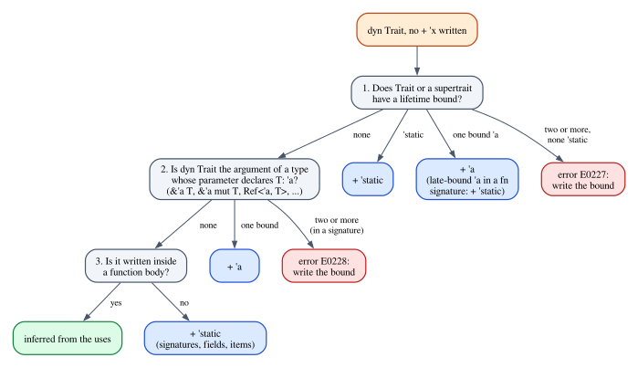

# Chapter 8 · Trait Objects, `impl Trait` and Captured Lifetimes

Rust has two ways to say "some type that implements this trait" without naming
the type. A trait object, `dyn Trait` behind a pointer, erases the type at run
time: a `Box<dyn Shape>` may hold a circle or a square, and calls go through a
table of function pointers. An `impl Trait` in return position hides the type
from the caller but not from the compiler: `fn chars_of(s: &str) -> impl
Iterator<Item = char>` returns one specific type, which the caller may use only
through `Iterator`.

Both hide a type, and a hidden type may contain borrows. The caller cannot look
inside to see what the value borrows, yet the borrow checker must know how long
the value may be used. So both kinds of type carry lifetime information that you
usually do not write: trait objects have a *lifetime bound* with default rules,
and opaque `impl Trait` types *capture* lifetimes by rules that changed in
edition 2024. Most of the time the defaults are right. When they are not, the
messages are some of the most puzzling the compiler produces: "returning this
value requires that `'1` must outlive `'static`" for code that never mentions
`'static`, or a borrow that lives too long because "Rust 2024 has adjusted the
`impl Trait` lifetime capture rules". This chapter writes out every default.

**In this chapter you will learn:**

- what the lifetime bound of a trait object means, and the complete rules for
  its default, as rustc 1.99 applies them (the Reference describes them
  inaccurately);
- why `Box<dyn Error>` and `?` reject errors that borrow their input, and the two
  ways out;
- where the bound is checked (unsizing coercions) and how to store borrowing
  trait objects in structs;
- what a return-position `impl Trait` captures in edition 2024, the
  over-capturing problem, and precise capturing with `use<..>`;
- why `impl Trait + 'a` is not the same as `use<'a>`;
- the edition 2021 rules and E0700, for the code you will still read;
- how `impl Trait` in traits, `async fn` and `impl Trait` in argument position
  capture lifetimes.

## The lifetime bound of a trait object

### What `dyn Trait + 'a` says

A value of type `dyn Shape` is a value of some concrete type that implements
`Shape`, with the concrete type forgotten. Once it is forgotten, the compiler can
no longer see whether the value contains references, or how long they are valid.
The *lifetime bound* of the trait object, the `'a` in `dyn Shape + 'a`, is the
part of the type that keeps that information: `dyn Shape + 'a` stands for "some
type `T` with `T: Shape` and `T: 'a`". Recall from Chapter 1 that `T: 'a` means
every lifetime inside `T` outlives `'a`. A `dyn Shape + 'static` contains no
borrow that can expire; a `dyn Shape + 'a` may contain borrows, all of them
valid for at least `'a`, and so it may be used only within `'a`.

Every trait object type has such a bound. A longer bound can stand in for a
shorter one (`dyn Shape + 'static` can be used where `dyn Shape + 'a` is
expected; Chapter 4 lists `dyn Trait + 'a` as covariant in `'a`), but never the
other way around. When you write `dyn Shape` with no bound, the compiler picks
one: the *default object lifetime bound*. Like elision, the default is a rule
about how the compiler reads a type; it never looks at how the value is used.

### The defaults at work

The program `code/examples/ch08_object_defaults.rs` has a trait and two shapes,
one that borrows its data and one that owns it:

```rust
trait Shape {
    fn area(&self) -> f64;
}

/// A circle that borrows its radius, from a configuration for example.
struct Circle<'a> {
    radius: &'a f64,
}

impl Shape for Circle<'_> {
    fn area(&self) -> f64 {
        std::f64::consts::PI * self.radius * self.radius
    }
}

/// A square that owns its data.
struct Square(f64);

impl Shape for Square {
    fn area(&self) -> f64 {
        self.0 * self.0
    }
}
```

Boxing a circle needs a bound in the return type, and boxing a square does not:

```rust
// The default would be `Box<dyn Shape + 'static>`: the bound must be written.
fn boxed_circle<'a>(radius: &'a f64) -> Box<dyn Shape + 'a> {
    Box::new(Circle { radius })
}

// A square borrows nothing, so the `'static` default is the right contract.
fn boxed_square(side: f64) -> Box<dyn Shape> {
    Box::new(Square(side))
}
```

`Box<dyn Shape>` means `Box<dyn Shape + 'static>`. That is the right contract for
`boxed_square`, whose result owns everything, and the wrong one for
`boxed_circle`, whose result borrows `radius`. Without `+ 'a`, the compiler
reports "returning this value requires that `'a` must outlive `'static`", the
error Chapter 6 read label by label for a boxed closure. References are
different:

```rust
// The defaults are already right here: `&'x [&'y (dyn Shape + 'y)]`.
fn total(shapes: &[&dyn Shape]) -> f64 {
    shapes.iter().map(|shape| shape.area()).sum()
}
```

The parameter `&[&dyn Shape]` means `&'x [&'y (dyn Shape + 'y)]`: the default
for a trait object behind a reference is the lifetime of that reference. That is
almost always what you want, since the object cannot be used after the reference
expires anyway. So `total` accepts the borrowing circle, a box's contents and a
square alike:

```rust
fn main() {
    let radius = 2.0;
    let circle = boxed_circle(&radius);
    let square = boxed_square(3.0);
    let local = Circle { radius: &radius };
    println!("{:.2} {:.2}", circle.area(), square.area());
    println!("{:.2}", total(&[&local, &*circle, &*square]));
}
```

```text
12.57 9.00
34.13
```

Here are the defaults for the types you will meet most often:

| You write | It means | Why |
|---|---|---|
| `Box<dyn Shape>` | `Box<dyn Shape + 'static>` | `Box<T>` gives no bound |
| `Rc<dyn Shape>`, `Arc<dyn Shape>` | `... + 'static` | the same |
| `&'a dyn Shape` | `&'a (dyn Shape + 'a)` | `&'a T` requires `T: 'a` |
| `&'a mut dyn Shape` | `&'a mut (dyn Shape + 'a)` | the same |
| `Ref<'a, dyn Shape>` | `Ref<'a, dyn Shape + 'a>` | `Ref` declares `T: 'a` |
| `&'a Box<dyn Shape>` | `&'a Box<dyn Shape + 'static>` | the innermost type decides |
| `dyn Shape` in a function body | inferred | from the uses |

The program `code/examples/ch08_default_table.rs` checks every row. Each
function converts a `&mut` to the elided form into a `&mut` to the explicit form.
Because `&mut T` is invariant in `T` (Chapter 4), and each `T` here is a sized
type (a reference, a `Box`, a `Ref`) that no coercion can change behind the
`&mut`, the function compiles only if the two types are identical, that is, only
if the row is right:

```rust
// No lifetime on the container: `'static`.
fn in_box<'s>(x: &'s mut Box<dyn Shape>) -> &'s mut Box<dyn Shape + 'static> {
    x
}
fn in_rc<'s>(x: &'s mut Rc<dyn Shape>) -> &'s mut Rc<dyn Shape + 'static> {
    x
}
fn in_arc<'s>(x: &'s mut Arc<dyn Shape>) -> &'s mut Arc<dyn Shape + 'static> {
    x
}

// A reference or a `Ref` to the object: the lifetime of the borrow.
fn in_ref<'s, 'a>(x: &'s mut &'a dyn Shape) -> &'s mut &'a (dyn Shape + 'a) {
    x
}
fn in_mut<'s, 'a>(x: &'s mut &'a mut dyn Shape) -> &'s mut &'a mut (dyn Shape + 'a) {
    x
}
fn in_cell_ref<'s, 'a>(
    x: &'s mut Ref<'a, dyn Shape>,
) -> &'s mut Ref<'a, dyn Shape + 'a> {
    x
}

// The innermost container decides: a `Box` behind a reference is still `'static`.
fn box_behind_ref<'s, 'a>(
    x: &'s mut &'a Box<dyn Shape>,
) -> &'s mut &'a Box<dyn Shape + 'static> {
    x
}
```

The last row is the one that surprises people. In `&'a Box<dyn Shape>`, the
trait object is an argument of `Box`, not of `&'a`, and `Box` gives no bound,
so the object is `'static` even though it sits behind a short reference. The
same program checks the body row, a `Box<dyn Display>` that borrows a local
variable:

```rust
// In a function body an elided bound is inferred: this box may borrow `name`.
let name = String::from("local");
let shown: Box<dyn Display> = Box::new(&name);
println!("{shown}");
```

Inside a function body there are no signatures to agree on, and an elided bound
becomes one more lifetime for the borrow checker to infer.

### The rules

Behind the table are three rules, which rustc 1.99 applies in this order:

1. **The trait's own bounds.** If the trait, or one of its supertraits, declares
   a lifetime bound on `Self` (`trait Plugin: 'static`, `trait Source<'a>: 'a`),
   that bound is the default: `'static` if it is among them, otherwise the bound
   if there is exactly one, and error E0227 if there are several.
2. **The containing type.** Otherwise, if the trait object is the argument of a
   type whose parameter declares a lifetime bound, that bound is the default:
   `'a` for `&'a T` and `&'a mut T`, `'b` for `Ref<'b, T: ?Sized + 'b>`, and the
   same for your own types. Two different bounds give error E0228.
3. **Otherwise**, the bound is inferred inside a function body, and it is
   `'static` everywhere else: in signatures, struct fields, type aliases and
   `impl` headers (Chapter 6 showed `impl dyn Shape`).



> [!NOTE]
> The Rust Reference describes these defaults in its page on lifetime elision
> (https://doc.rust-lang.org/reference/lifetime-elision.html#default-trait-object-lifetimes),
> but lists the rules in the opposite order, containing type first. That section
> is known to be inaccurate: issue rust-lang/reference#1407
> (https://github.com/rust-lang/reference/issues/1407) collects the differences,
> and the open pull request rust-lang/reference#2281 reorders the rules to match
> rustc, which "looks at the outlives-bounds of the principal trait (and its
> supertraits) *first*". This chapter describes what rustc 1.99 does, checked by
> the programs shown. Rust 1.98 also fixed the defaults inside trait references
> and associated-type paths (rust-lang/rust#129543), a rare case that this
> chapter does not cover.

### Traits with a lifetime bound

Rule 1 is easy to miss because few traits have a lifetime bound. Here is one
that does, from `code/examples/ch08_trait_bounds.rs`: plugins are kept in global
registries, so the trait requires `'static`.

```rust
/// Plugins are stored in global registries, so the trait requires `'static`.
trait Plugin: 'static {
    fn name(&self) -> String;
}

struct Upper;

impl Plugin for Upper {
    fn name(&self) -> String {
        "upper".to_string()
    }
}

// `&dyn Plugin` is `&'_ (dyn Plugin + 'static)`: the trait's bound, not the
// reference's lifetime, is the default. The reference itself may be short.
fn describe(plugin: &dyn Plugin) -> String {
    format!("plugin {}", plugin.name())
}
```

The parameter `&dyn Plugin` means `&'_ (dyn Plugin + 'static)`, by rule 1, and
not `&'a (dyn Plugin + 'a)` as rule 2 would have it. A bound inherited from a
supertrait counts too:

```rust
// A bound inherited from a supertrait counts too: `&dyn Loud` is
// `&'_ (dyn Loud + 'static)`.
trait Loud: Plugin {
    fn shout(&self) -> String {
        self.name().to_uppercase()
    }
}

impl Loud for Upper {}

fn announce(plugin: &dyn Loud) -> String {
    plugin.shout()
}
```

`main` passes a short borrow of a local variable to both functions:

```rust
fn main() {
    let local = Upper; // a local variable: the borrow below is short
    println!("{} / {}", describe(&local), announce(&local));

    let config = String::from("port = 8080");
    println!("{}", boxed_source(&config).text());
}
```

```text
plugin upper / UPPER
port = 8080
```

The order of the rules matters here, and the reason it is the right order shows
when you write rule 2's answer by hand
(`code/compile_fail/ch08_trait_bounds_explicit.rs`):

```rust
pub fn describe<'a>(plugin: &'a (dyn Plugin + 'a)) -> String {
    format!("plugin {}", plugin.name())
}

pub fn caller() -> String {
    let local = Upper;
    describe(&local)
}
```

```text
error[E0597]: `local` does not live long enough
  --> compile_fail/ch08_trait_bounds_explicit.rs:25:14
   |
24 |     let local = Upper;
   |         ----- binding `local` declared here
25 |     describe(&local)
   |     ---------^^^^^^-
   |     |        |
   |     |        borrowed value does not live long enough
   |     argument requires that `local` is borrowed for `'static`
26 | }
   | - `local` dropped here while still borrowed
```

"Argument requires that `local` is borrowed for `'static`": a reference to a
local variable is no longer accepted. Because `Plugin: 'static`, the type
`dyn Plugin + 'a` is well-formed only if `'a` outlives `'static`, so the
signature of `describe` carries the implied bound `'a: 'static` (Chapter 7 met
the same effect with `dyn Any + 'src`), and every caller must provide a `'static`
borrow. With the trait's bound as the default, the object is `'static` and the
reference can be as short as you like.

For a trait with a lifetime parameter, such as `trait Source<'a>: 'a`, rule 1
gives `'a`, and in a type alias that is what you get:

```rust
/// A source of text that lives at least as long as `'a`.
trait Source<'a>: 'a {
    fn text(&self) -> &'a str;
}

impl<'a> Source<'a> for &'a str {
    fn text(&self) -> &'a str {
        self
    }
}

// In a type alias the trait's bound applies: this is `Box<dyn Source<'a> + 'a>`.
type BoxedSource<'a> = Box<dyn Source<'a>>;

fn boxed_source<'a>(text: &'a str) -> BoxedSource<'a> {
    Box::new(text)
}
```

The same type written directly in a function signature is a different story
(`code/compile_fail/ch08_late_bound_default.rs`):

```rust
pub fn boxed_source<'a>(text: &'a str) -> Box<dyn Source<'a>> {
    Box::new(text)
}
```

```text
error: lifetime may not live long enough
  --> compile_fail/ch08_late_bound_default.rs:18:5
   |
17 | pub fn boxed_source<'a>(text: &'a str) -> Box<dyn Source<'a>> {
   |                     -- lifetime `'a` defined here
18 |     Box::new(text)
   |     ^^^^^^^^^^^^^^ returning this value requires that `'a` must outlive `'static`
   |
help: to declare that the trait object captures data from argument `text`, you can add an explicit `'a` lifetime bound
   |
17 | pub fn boxed_source<'a>(text: &'a str) -> Box<dyn Source<'a> + 'a> {
   |                                                              ++++
```

The Reference says that `Box<dyn Source<'a>>` means `Box<dyn Source<'a> + 'a>`,
and rustc 1.99 reads it as `Box<dyn Source<'a> + 'static>`. The difference is
that the `'a` of `boxed_source` is a *late-bound* lifetime, a technical
distinction that Chapter 9 explains; rule 1 applies only when the trait's
lifetime argument is an ordinary, *early-bound* parameter, as in the type alias.
Issue rust-lang/reference#1407 lists this case. The practical advice is simple:
when you rely on a bound other than `'static`, write it, as the help suggests.

### When there is no unique default

Rules 1 and 2 can each find more than one bound, and then you must write it.
A struct whose type parameter must outlive two lifetimes
(`code/compile_fail/ch08_two_bounds.rs`):

```rust
/// Pairs a shape with the labels of two different documents.
pub struct Labeled<'a, 'b, T: ?Sized + 'a + 'b> {
    pub title: &'a str,
    pub note: &'b str,
    pub shape: Box<T>,
}

pub fn area_of(item: &Labeled<'_, '_, dyn Shape>) -> f64 {
    item.shape.area()
}
```

```text
error[E0228]: cannot deduce the lifetime bound for this trait object type from context
  --> compile_fail/ch08_two_bounds.rs:17:39
   |
17 | pub fn area_of(item: &Labeled<'_, '_, dyn Shape>) -> f64 {
   |                                       ^^^^^^^^^
   |
help: please supply an explicit bound
   |
17 | pub fn area_of(item: &Labeled<'_, '_, dyn Shape + /* 'a */>) -> f64 {
   |                                                 ++++++++++
```

E0228, "cannot deduce the lifetime bound for this trait object type from
context". The help leaves a placeholder, `dyn Shape + /* 'a */`, for you to fill
in. A trait with two lifetime bounds, neither of them `'static`, is E0227
(`code/compile_fail/ch08_two_trait_bounds.rs`):

```rust
/// A table whose keys live for `'k` and whose values live for `'v`.
pub trait Lookup<'k, 'v>: 'k + 'v {
    fn get(&self, key: &str) -> Option<&'v str>;
}

pub type BoxedLookup<'k, 'v> = Box<dyn Lookup<'k, 'v>>;
```

```text
error[E0227]: ambiguous lifetime bound, explicit lifetime bound required
  --> compile_fail/ch08_two_trait_bounds.rs:11:36
   |
11 | pub type BoxedLookup<'k, 'v> = Box<dyn Lookup<'k, 'v>>;
   |                                    ^^^^^^^^^^^^^^^^^^
```

## `Box<dyn Error>` and `?`

`Box<dyn Error>` is the usual "any error" type of applications and examples, and
`?` converts errors into it. The conversion is the standard library's
`impl<'a, E: Error + 'a> From<E> for Box<dyn Error + 'a>`: any error type can
become a boxed trait object whose bound it satisfies. With the default bound,
`Box<dyn Error>` is `Box<dyn Error + 'static>`, and an error type that borrows its
input does not satisfy it (`code/compile_fail/ch08_error_box_static.rs`):

```rust
pub fn parse_port(s: &str) -> Result<u16, Box<dyn Error>> {
    let port: u16 = s.trim().parse().map_err(|_| BadNumber { input: s })?;
    Ok(port)
}
```

```text
error: lifetime may not live long enough
  --> compile_fail/ch08_error_box_static.rs:23:21
   |
22 | pub fn parse_port(s: &str) -> Result<u16, Box<dyn Error>> {
   |                      - let's call the lifetime of this reference `'1`
23 |     let port: u16 = s.trim().parse().map_err(|_| BadNumber { input: s })?;
   |                     ^^^^^^^^^^^^^^^^^^^^^^^^^^^^^^^^^^^^^^^^^^^^^^^^^^^^^ returning this value requires that `'1` must outlive `'static`
   |
help: to declare that the trait object captures data from argument `s`, you can add an explicit `'_` lifetime bound
   |
22 | pub fn parse_port(s: &str) -> Result<u16, Box<dyn Error + '_>> {
   |                                                         ++++
```

The label "returning this value" points at the whole `...?` expression, because
on an error `?` returns early, converting `BadNumber { input: s }` into the
function's error type. A `BadNumber<'1>` in a `Box<dyn Error + 'static>` requires
`'1` to outlive `'static`. There are two ways out, and they are a design choice.

The first is the help's: let the box borrow, with `+ '_`. It is in
`code/examples/ch08_error_box.rs`:

```rust
/// An error that points into the input: cheap, but tied to the input's lifetime.
#[derive(Debug)]
struct BadNumber<'a> {
    input: &'a str,
}

impl fmt::Display for BadNumber<'_> {
    fn fmt(&self, f: &mut fmt::Formatter<'_>) -> fmt::Result {
        write!(f, "not a number: {:?}", self.input)
    }
}

impl Error for BadNumber<'_> {}

// `?` converts `BadNumber<'_>` into `Box<dyn Error + '_>`: the box may borrow `s`.
fn parse_port(s: &str) -> Result<u16, Box<dyn Error + '_>> {
    let port: u16 = s.trim().parse().map_err(|_| BadNumber { input: s })?;
    Ok(port)
}
```

This is cheap (nothing is copied) and precise (the error points into the
input), but the error now lives no longer than the input. A function that owns
the input cannot pass the error on to its caller
(`code/compile_fail/ch08_error_escapes.rs`):

```rust
pub fn load_port() -> Result<u16, Box<dyn Error>> {
    let line = String::from(" 80x ");
    let port = parse_port(&line)?;
    Ok(port)
}
```

```text
error[E0515]: cannot return value referencing local variable `line`
  --> compile_fail/ch08_error_escapes.rs:29:16
   |
29 |     let port = parse_port(&line)?;
   |                ^^^^^^^^^^^-----^^
   |                |          |
   |                |          `line` is borrowed here
   |                returns a value referencing data owned by the current function
```

E0515, "cannot return value referencing local variable `line`": the error
returned by `?` borrows `line`, which is dropped when `load_port` returns. The
second way out avoids this: the error owns a copy of the input, satisfies
`'static`, and fits the default `Box<dyn Error>`:

```rust
/// The same error, owning a copy of the input: it satisfies `'static`.
#[derive(Debug)]
struct BadPort {
    input: String,
}

impl fmt::Display for BadPort {
    fn fmt(&self, f: &mut fmt::Formatter<'_>) -> fmt::Result {
        write!(f, "not a port: {:?}", self.input)
    }
}

impl Error for BadPort {}

fn parse_port_owned(s: &str) -> Result<u16, Box<dyn Error>> {
    let port: u16 = s.trim().parse().map_err(|_| BadPort { input: s.into() })?;
    Ok(port)
}

// The owned error can leave the function that owns the text.
fn load_port() -> Result<u16, Box<dyn Error>> {
    let line = String::from(" 80x ");
    let port = parse_port_owned(&line)?;
    Ok(port)
}
```

```rust
fn main() {
    let lines = [String::from("8080"), String::from("80x")];
    for line in &lines {
        match parse_port(line) {
            Ok(port) => println!("port {port}"),
            Err(e) => println!("error: {e}"),
        }
    }
    if let Err(e) = load_port() {
        println!("error: {e}");
    }
}
```

```text
port 8080
error: not a number: "80x"
error: not a port: " 80x "
```

Borrowed errors suit code that parses and reports on the spot. Errors that
travel up a call stack, cross threads or end up in a log should own their data;
copying a short input on the error path costs little. Chapter 14 returns to this
choice for library APIs.

## Unsizing coercions: where the bound is checked

A trait object is never created directly. It is made by an *unsizing coercion*,
which turns a pointer to a concrete type into a pointer to a trait object:
`&Circle<'_>` into `&dyn Shape`, `Box<Circle<'_>>` into `Box<dyn Shape>`, and the
same for `&mut`, `Rc` and `Arc`. The compiler inserts the coercion where the
expected type is known: an annotated `let`, a function argument, a return value,
a field in a struct literal, an element of an array. The coercion from `T` to
`dyn Trait + 'x` requires `T: Trait` and `T: 'x`, and this is where the object
bound is checked. When the check fails, the borrow checker's label says
"coercion requires that ... is borrowed for `'static`", as in Chapter 7's
registry. From `code/examples/ch08_coercions.rs`:

```rust
let (r1, r2) = (1.0, 2.0);
let small = Circle { radius: &r1 };
let big = Circle { radius: &r2 };
// `&Circle<'_>` to `&dyn Shape`: the array's type asks for the coercion.
let shapes: [&dyn Shape; 2] = [&small, &big];
println!("largest: {:.2}", largest(&shapes).area());

// `Box<Circle<'_>>` to `Box<dyn Shape + '_>`: the bound is inferred here.
let boxed: Box<dyn Shape + '_> = Box::new(Circle { radius: &r2 });
println!("boxed: {:.2}", boxed.area());
```

```rust
fn largest<'a>(shapes: &[&'a dyn Shape]) -> &'a dyn Shape {
    let mut best = shapes[0];
    for &shape in shapes {
        if shape.area() > best.area() {
            best = shape;
        }
    }
    best
}
```

In the array, each `&Circle<'_>` becomes a `&dyn Shape`, whose bound is the
lifetime of the reference. In `largest`, `&'a dyn Shape` is
`&'a (dyn Shape + 'a)`, so the result can be returned with the lifetime of the
input references. In the `let` with `Box<dyn Shape + '_>`, the `'_` is in a
function body, so the bound is inferred.

A trait object with a long bound can be used where a shorter bound is expected,
in a box and even behind `&mut`:

```rust
// A `'static` object is accepted where a shorter bound is expected...
fn shorten<'a>(shape: Box<dyn Shape>) -> Box<dyn Shape + 'a> {
    shape
}

// ...even behind `&mut`: the coercion builds a new pointer to the same object.
fn shorten_mut<'a>(shape: &'a mut (dyn Shape + 'static)) -> &'a mut (dyn Shape + 'a) {
    shape
}
```

```text
largest: 12.57
boxed: 12.57
2.25
9.00
```

`shorten_mut` is allowed although `&mut T` is invariant in `T`, because it is
not subtyping: it is a coercion that builds a new pointer, a
`&'a mut (dyn Shape + 'a)`, to the same object. Through that pointer you can
call methods on the object, but you cannot replace it with a different value,
because a `dyn Shape` has no size known at compile time and cannot be assigned.
The same is not true one level down (`code/compile_fail/ch08_mut_box_invariant.rs`):

```rust
pub fn shorten_slot<'a>(slot: &'a mut Box<dyn Shape>) -> &'a mut Box<dyn Shape + 'a> {
    slot
}
```

```text
error: lifetime may not live long enough
  --> compile_fail/ch08_mut_box_invariant.rs:12:5
   |
11 | pub fn shorten_slot<'a>(slot: &'a mut Box<dyn Shape>) -> &'a mut Box<dyn Shape + 'a> {
   |                     -- lifetime `'a` defined here
12 |     slot
   |     ^^^^ returning this value requires that `'a` must outlive `'static`
   |
   = note: requirement occurs because of a mutable reference to `Box<dyn Shape>`
   = note: mutable references are invariant over their type parameter
   = help: see <https://doc.rust-lang.org/nomicon/subtyping.html> for more information about variance
```

Through a `&mut Box<dyn Shape + 'a>` you could store a new box holding a circle
that borrows a short-lived radius, and the original owner would later find it in
a slot that promises `'static`. The notes give the reason in general terms:
"mutable references are invariant over their type parameter" (Chapter 4).

## Trait objects in structs

A struct that stores trait objects decides, in its field types, how long they may
borrow. Chapter 7's `Registry` stored `Box<dyn Fn(&str) -> String>`, which means
`+ 'static`, so every callback had to own its data. Writing the bound as a
lifetime parameter of the struct admits borrowing callbacks. The filter in
`code/examples/ch08_struct_fields.rs` keeps rules that may borrow from the code
that builds it:

```rust
/// A word filter whose rules may borrow from the code that builds it.
struct Filter<'a> {
    rules: Vec<Box<dyn Fn(&str) -> bool + 'a>>,
}

impl<'a> Filter<'a> {
    fn new() -> Self {
        Filter { rules: Vec::new() }
    }

    fn rule(mut self, rule: impl Fn(&str) -> bool + 'a) -> Self {
        self.rules.push(Box::new(rule));
        self
    }

    fn accepts(&self, word: &str) -> bool {
        self.rules.iter().all(|rule| rule(word))
    }
}
```

The `+ 'a` appears twice: in the field, where it is the bound of the stored
objects, and on the parameter of `rule`, where `impl Fn(&str) -> bool + 'a`
requires the closure's type to outlive `'a` so that the coercion to
`Box<dyn Fn(&str) -> bool + 'a>` succeeds. Both rules in `main` borrow local
variables:

```rust
let stop_words = vec!["the".to_string(), "a".to_string()];
let min_len = 3;
let filter = Filter::new()
    .rule(|w| !stop_words.iter().any(|s| s == w)) // borrows `stop_words`
    .rule(|w| w.len() >= min_len); // borrows `min_len`
let text = "the parser reads a token stream";
let kept: Vec<&str> = text.split(' ').filter(|w| filter.accepts(w)).collect();
println!("{kept:?}");
```

```text
["parser", "reads", "token", "stream"]
```

The price is the usual price of a lifetime parameter: a `Filter<'a>` cannot
outlive `stop_words` and `min_len`, so it cannot be returned from the function
that owns them or stored in a `static`. Choose between the two designs as
Chapter 7 chose for the registry; Chapter 14 builds a larger example.

### Generic containers and rule 2

The second half of the example is a generic struct that holds a reference to any
value, including an unsized one:

```rust
trait Shape {
    fn area(&self) -> f64;
}

struct Circle<'a> {
    radius: &'a f64,
}

impl Shape for Circle<'_> {
    fn area(&self) -> f64 {
        std::f64::consts::PI * self.radius * self.radius
    }
}

/// A labeled reference. `T: ?Sized + 'a` is declared, so in
/// `Labeled<'a, dyn Shape>` the object's default bound is `'a`.
struct Labeled<'a, T: ?Sized + 'a> {
    label: &'a str,
    value: &'a T,
}

fn describe(item: &Labeled<'_, dyn Shape>) -> String {
    format!("{} has area {:.2}", item.label, item.value.area())
}
```

The declaration `T: ?Sized + 'a` is what makes `Labeled<'_, dyn Shape>` mean
`Labeled<'_, dyn Shape + '_>`, by rule 2, exactly as `Ref` does. So `describe`
accepts a label for a circle that borrows a local variable:

```rust
let radius = 1.0;
let circle = Circle { radius: &radius };
// The struct literal is built with `T = dyn Shape`: `&circle` is coerced.
let item: Labeled<'_, dyn Shape> = Labeled {
    label: "unit circle",
    value: &circle,
};
println!("{}", describe(&item));
```

```text
unit circle has area 3.14
```

Without the declared bound, the containing type gives no default and rule 3
applies, even
though the field is a `&'a T` and the compiler knows `T: 'a` must hold
(`code/compile_fail/ch08_unbounded_param.rs`):

```rust
pub struct Labeled<'a, T: ?Sized> {
    pub label: &'a str,
    pub value: &'a T,
}

pub fn describe(item: &Labeled<'_, dyn Shape>) -> String {
    format!("{} has area {:.2}", item.label, item.value.area())
}

pub fn caller() -> String {
    let radius = 1.0;
    let circle = Circle { radius: &radius };
    describe(&Labeled {
        label: "unit circle",
        value: &circle,
    })
}
```

```text
error[E0597]: `radius` does not live long enough
  --> compile_fail/ch08_unbounded_param.rs:32:35
   |
31 |       let radius = 1.0;
   |           ------ binding `radius` declared here
32 |       let circle = Circle { radius: &radius };
   |                                     ^^^^^^^ borrowed value does not live long enough
33 | /     describe(&Labeled {
34 | |         label: "unit circle",
35 | |         value: &circle,
36 | |     })
   | |______- argument requires that `radius` is borrowed for `'static`
37 |   }
   |   - `radius` dropped here while still borrowed
```

The circle borrows `radius`, and "argument requires that `radius` is borrowed for
`'static`" reveals that `describe` now wants a `dyn Shape + 'static`. The bound
that `&'a T` implies is not used for the default; only bounds written on the
type's parameters count. If you write a container meant to hold trait objects,
declare `T: ?Sized + 'a`.

## Return-position `impl Trait`: what an opaque type captures

A function that returns `impl Iterator<Item = char>` returns an *opaque type*:
a type that the compiler knows (the *hidden type*, chosen by the body) but that
callers may use only through the listed traits. Here is the simplest example,
from `code/examples/ch08_rpit_captures.rs`:

```rust
fn chars_of(s: &str) -> impl Iterator<Item = char> {
    s.chars() // the hidden type is `Chars<'_>`, which borrows `s`
}
```

The hidden type `Chars<'_>` borrows `s`. For callers to use the result safely,
the opaque type must reveal at least *which* lifetimes the hidden type may
depend on, without revealing the type itself. It does so by *capturing* generic
parameters: the opaque type behaves like a type with parameters, say
`CharsOf<'s>`, and a value of it keeps every captured lifetime alive as long as
the value is used. A lifetime that is not captured cannot appear in the hidden
type at all.

In edition 2024, the rule is the simplest one possible. The edition guide puts
it in one sentence: "In Rust 2024, all in-scope generic parameters, including
lifetime parameters, are implicitly captured when the `use<..>` bound is not
present." The elided lifetime of `s` is an anonymous lifetime parameter of
`chars_of`, so it is captured, and `chars_of` compiles. Written out, with the
precise capturing syntax `use<..>` that lists the captures:

```rust
// The same contract with the captures written out.
fn chars_of_explicit<'s>(s: &'s str) -> impl Iterator<Item = char> + use<'s> {
    s.chars()
}
```

A result that borrows from two inputs captures both lifetimes, with no
annotation:

```rust
// The hidden type borrows from both inputs, and both lifetimes are captured.
fn both<'a, 'b>(x: &'a str, y: &'b str) -> impl Iterator<Item = char> {
    x.chars().chain(y.chars())
}
```

Type parameters have always been captured, in every edition:

```rust
// Type parameters have always been captured, in every edition.
fn repeated<T: Clone>(item: T, times: usize) -> impl Iterator<Item = T> {
    std::iter::repeat_n(item, times)
}
```

```text
ABC 3 ["ok", "ok"] abc!
```

The signature is still the contract: a caller of `chars_of` knows only that the
result may borrow from `s`, and it is checked against that, whether or not the
body actually borrows.

## Over-capturing and precise capturing with `use<..>`

Capturing everything is safe and usually right. It is wrong when the hidden type
does not borrow from every input, because callers then keep inputs borrowed for
nothing. Here is a function that skips a prefix (`code/compile_fail/ch08_overcapture.rs`):

```rust
pub fn after_prefix<'s>(s: &'s str, prefix: &str) -> impl Iterator<Item = char> {
    s.strip_prefix(prefix).unwrap_or(s).chars()
}
```

The iterator borrows `s` only; `prefix` is used during the call and never again.
But the opaque type captures both lifetimes, so a caller that drops the prefix
early is rejected:

```rust
pub fn caller() -> String {
    let text = String::from("> hello");
    let chars;
    {
        let prefix = String::from("> ");
        chars = after_prefix(&text, &prefix);
    } // `prefix` is dropped here
    chars.collect()
}
```

```text
error[E0597]: `prefix` does not live long enough
  --> compile_fail/ch08_overcapture.rs:18:37
   |
17 |         let prefix = String::from("> ");
   |             ------ binding `prefix` declared here
18 |         chars = after_prefix(&text, &prefix);
   |                                     ^^^^^^^ borrowed value does not live long enough
19 |     } // `prefix` is dropped here
   |     - `prefix` dropped here while still borrowed
20 |     chars.collect()
   |     ----- borrow later used here
   |
note: this call may capture more lifetimes than intended, because Rust 2024 has adjusted the `impl Trait` lifetime capture rules
  --> compile_fail/ch08_overcapture.rs:18:17
   |
18 |         chars = after_prefix(&text, &prefix);
   |                 ^^^^^^^^^^^^^^^^^^^^^^^^^^^^
help: use the precise capturing `use<...>` syntax to make the captures explicit
   |
 7 | pub fn after_prefix<'s>(s: &'s str, prefix: &str) -> impl Iterator<Item = char> + use<> {
   |                                                                                 +++++++
```

E0597, "`prefix` does not live long enough", with the three usual labels: the
borrow, the drop at the end of the block, and the later use of `chars`. The
note is new: "this call may capture more lifetimes than intended, because Rust
2024 has adjusted the `impl Trait` lifetime capture rules". The help suggests
`use<>`, an empty capture list. Applying it literally
(`code/compile_fail/ch08_use_nothing.rs`):

```rust
fn after_prefix<'s>(s: &'s str, prefix: &str) -> impl Iterator<Item = char> + use<> {
    s.strip_prefix(prefix).unwrap_or(s).chars()
}
```

```text
error[E0700]: hidden type for `impl Iterator<Item = char>` captures lifetime that does not appear in bounds
 --> compile_fail/ch08_use_nothing.rs:7:5
  |
6 | fn after_prefix<'s>(s: &'s str, prefix: &str) -> impl Iterator<Item = char> + use<> {
  |                 --                               ---------------------------------- opaque type defined here
  |                 |
  |                 hidden type `Chars<'s>` captures the lifetime `'s` as defined here
7 |     s.strip_prefix(prefix).unwrap_or(s).chars()
  |     ^^^^^^^^^^^^^^^^^^^^^^^^^^^^^^^^^^^^^^^^^^^
  |
help: add `'s` to the `use<...>` bound to explicitly capture it
  |
6 | fn after_prefix<'s>(s: &'s str, prefix: &str) -> impl Iterator<Item = char> + use<'s> {
  |                                                                                   ++
```

E0700, "hidden type for `impl Iterator<Item = char>` captures lifetime that
does not appear in bounds": the hidden type `Chars<'s>` borrows `s`, and `use<>`
just forbade that. The suggestion at the call site is a generic one, made
without knowing what the hidden type needs. The second help is the right
answer, and it is in `code/examples/ch08_precise_capture.rs`:

```rust
// The iterator borrows `s` only; `prefix` is used during the call and forgotten.
fn after_prefix<'s>(s: &'s str, prefix: &str) -> impl Iterator<Item = char> + use<'s> {
    s.strip_prefix(prefix).unwrap_or(s).chars()
}
```

`use<'s>` captures `'s` and nothing else. When the result borrows nothing at
all, the empty list is the right one:

```rust
// A result that borrows nothing: capture nothing.
fn char_count(s: &str) -> impl Display + use<> {
    s.chars().count()
}
```

`use<..>` follows a few rules, all checked by rustc 1.99:

- It lists the generic parameters that the hidden type may use: lifetimes, type
  parameters and const parameters. `use<'_>` names the lifetime that elision
  picks for the output (Chapter 6).
- It can leave out lifetimes only. Every type parameter in scope must be listed
  (`code/compile_fail/ch08_use_all_types.rs`):

```rust
pub fn tagged<T: Display>(tag: T, text: &str) -> impl Display + use<'_> {
    format!("[{tag}] {text}")
}
```

```text
error: `impl Trait` must mention all type parameters in scope in `use<...>`
 --> compile_fail/ch08_use_all_types.rs:8:50
  |
8 | pub fn tagged<T: Display>(tag: T, text: &str) -> impl Display + use<'_> {
  |               -                                  ^^^^^^^^^^^^^^^^^^^^^^
  |               |
  |               type parameter is implicitly captured by this `impl Trait`
  |
  = note: currently, all type parameters are required to be mentioned in the precise captures list
```

- In a trait, it must list `Self` as well (see *`impl Trait` in traits and
  `async fn`* below), and it cannot name an `impl Trait` argument (see
  *`impl Trait` in argument position*).

> [!NOTE]
> Precise capturing with `use<..>` is stable since Rust 1.82 (October 2024) in
> all editions, and in `impl Trait` inside traits since Rust 1.87. Edition 2024,
> with its capture-everything default, is stable since Rust 1.85.

## `impl Trait + 'a` is not `use<'a>`

Before `use<..>` existed, code wrote `impl Trait + 'a`, and you will see both.
They answer different questions. `use<'a>` is a *capture list*: the hidden type
may mention `'a` (and the other listed parameters) and no other lifetime. `+ 'a`
is an *outlives bound*: the hidden type, whatever it captures, outlives `'a`.

Sometimes the bound has the effect you want. `after_prefix_outlives` keeps
capturing both lifetimes but promises that the hidden type outlives `'s`:

```rust
// An outlives bound instead of a capture list. It captures `prefix`'s lifetime
// too, but promises that the hidden type outlives `'s`.
fn after_prefix_outlives<'s>(
    s: &'s str,
    prefix: &str,
) -> impl Iterator<Item = char> + 's {
    s.strip_prefix(prefix).unwrap_or(s).chars()
}
```

The caller in the same example drops `prefix` before using the iterator, and
compiles:

```rust
fn main() {
    let text = String::from("> hello");
    let (chars, outlives, count);
    {
        let prefix = String::from("> ");
        chars = after_prefix(&text, &prefix);
        outlives = after_prefix_outlives(&text, &prefix);
        count = char_count(&prefix);
    } // `prefix` is dropped here; nothing returned borrows it
    println!("{} {} {count}", chars.collect::<String>(), outlives.count());

    let name = String::from("parser");
    println!("{}", labeled("name", &name)); // `T` is a short borrow: fine
}
```

```text
hello 5 2
name: parser
```

The borrow checker uses the bound: since the hidden type outlives `'s`, a value
of the opaque type stays valid as long as `'s` does, whatever else it captured.

But a bound is a requirement on the hidden type, and it can cost more than you
meant. It constrains type parameters too, so a hidden type that contains a `T`
requires `T: 'a` (`code/compile_fail/ch08_outlives_type_param.rs`):

```rust
pub fn labeled<'a, T: Display>(label: &'a str, value: T) -> impl Display + 'a {
    Labeled(label, value)
}
```

```text
error[E0309]: the parameter type `T` may not live long enough
  --> compile_fail/ch08_outlives_type_param.rs:17:5
   |
16 | pub fn labeled<'a, T: Display>(label: &'a str, value: T) -> impl Display + 'a {
   |                -- the parameter type `T` must be valid for the lifetime `'a` as defined here...
17 |     Labeled(label, value)
   |     ^^^^^^^^^^^^^^^^^^^^^ ...so that the type `T` will meet its required lifetime bounds
   |
help: consider adding an explicit lifetime bound
   |
16 | pub fn labeled<'a, T: Display + 'a>(label: &'a str, value: T) -> impl Display + 'a {
   |                               ++++
```

E0309, "the parameter type `T` may not live long enough", with a help that adds
`T: Display + 'a`. That fixes the function and moves the cost to callers, who may
then pass only values that outlive the label. The edition guide calls this
pattern the "outlives trick" and says it "created undue and surprising
restrictions on callers". The 2024 default has no such requirement:

```rust
struct Labeled<'a, T>(&'a str, T);

impl<T: Display> Display for Labeled<'_, T> {
    fn fmt(&self, f: &mut std::fmt::Formatter<'_>) -> std::fmt::Result {
        write!(f, "{}: {}", self.0, self.1)
    }
}

// The default captures `'a` and `T`, and asks nothing about how long `T` lives.
fn labeled<'a, T: Display>(label: &'a str, value: T) -> impl Display {
    Labeled(label, value)
}
```

And when the hidden type borrows from two inputs, `+ 'a` demands that both
borrows outlive `'a` (`code/compile_fail/ch08_outlives_two.rs`):

```rust
pub fn both<'a, 'b>(x: &'a str, y: &'b str) -> impl Iterator<Item = char> + 'a {
    x.chars().chain(y.chars())
}
```

```text
error: lifetime may not live long enough
 --> compile_fail/ch08_outlives_two.rs:7:5
  |
6 | pub fn both<'a, 'b>(x: &'a str, y: &'b str) -> impl Iterator<Item = char> + 'a {
  |             --  -- lifetime `'b` defined here
  |             |
  |             lifetime `'a` defined here
7 |     x.chars().chain(y.chars())
  |     ^^^^^^^^^^^^^^^^^^^^^^^^^^ function was supposed to return data with lifetime `'a` but it is returning data with lifetime `'b`
  |
  = help: consider adding the following bound: `'b: 'a`
```

"Function was supposed to return data with lifetime `'a` but it is returning data
with lifetime `'b`", and the help asks for `'b: 'a`. Without the `+ 'a`, the 2024
default captures both lifetimes and the function compiles as it is: it is `both`
in `ch08_rpit_captures.rs`.

So in edition 2024: write nothing when the result may borrow from every input,
`use<..>` to leave some lifetimes out, and `+ 'a` only when you mean an outlives
bound, for example `+ 'static` when callers need a value that borrows nothing.

## Edition 2021: E0700 and the outlives trick

Code written for edition 2021 and earlier follows a different capture rule:
type parameters are captured, but lifetime parameters only when they appear in
the bounds of the `impl Trait`. The `chars_of` that compiles in 2024 is
rejected there. The program `code/compile_fail/ch08_rpit_2021.rs` is compiled
with `edition=2021`:

```rust
pub fn chars_of(s: &str) -> impl Iterator<Item = char> {
    s.chars()
}
```

```text
error[E0700]: hidden type for `impl Iterator<Item = char>` captures lifetime that does not appear in bounds
 --> compile_fail/ch08_rpit_2021.rs:8:5
  |
7 | pub fn chars_of(s: &str) -> impl Iterator<Item = char> {
  |                    ----     -------------------------- opaque type defined here
  |                    |
  |                    hidden type `Chars<'_>` captures the anonymous lifetime defined here
8 |     s.chars()
  |     ^^^^^^^^^
  |
help: add a `use<...>` bound to explicitly capture `'_`
  |
7 | pub fn chars_of(s: &str) -> impl Iterator<Item = char> + use<'_> {
  |                                                        +++++++++
```

E0700 says that the hidden type uses a lifetime the opaque type does not capture:
"hidden type `Chars<'_>` captures the anonymous lifetime defined here", pointing
at `&str`. rustc 1.99 suggests `use<'_>`. Older compilers suggested `+ '_`, and
that is the fix you will find in 2021 code: mentioning `'_` in a bound made it
captured. The same file contains both fixes, and the only error reported is the
one above, so edition 2021 accepts both:

```rust
// The outlives trick: mentioning `'_` in a bound made it captured.
pub fn chars_outlives(s: &str) -> impl Iterator<Item = char> + '_ {
    s.chars()
}

// Precise capturing (Rust 1.82), which works in every edition.
pub fn chars_use(s: &str) -> impl Iterator<Item = char> + use<'_> {
    s.chars()
}
```

In edition 2024, both forms still compile, and `+ '_` now means only its
outlives bound. When `cargo fix --edition` migrates a crate to 2024, it keeps
the old meaning by adding `use<..>` where the new rule would capture more; the
lint behind it, `impl_trait_overcaptures`, is part of the
`rust-2024-compatibility` group. You may also meet a helper trait named
`Captures` in older code, a workaround for the same 2021 rule; the edition guide
notes that its uses "can be replaced by `use<..>` bounds (in all editions) or
removed entirely (in Rust 2024)".

## `impl Trait` in traits and `async fn`

A trait method can return `impl Trait` (stable since Rust 1.75, often called
RPITIT, "return-position `impl Trait` in traits"). Such an opaque type captures
every generic parameter in scope, `Self` and the elided lifetime of `&self`
included, in every edition. A generic caller knows only the trait's signature,
so it must assume that the result borrows the receiver
(`code/compile_fail/ch08_rpitit_captures.rs`):

```rust
pub trait Inventory {
    fn ids(&self) -> impl Iterator<Item = u32>;
}

pub fn restock<I: Inventory>(inventory: &mut I, add: impl FnOnce(&mut I)) -> u32 {
    let before = inventory.ids();
    add(inventory);
    before.sum()
}
```

```text
error[E0502]: cannot borrow `*inventory` as mutable because it is also borrowed as immutable
  --> compile_fail/ch08_rpitit_captures.rs:12:5
   |
11 |     let before = inventory.ids();
   |                  --------- immutable borrow occurs here
12 |     add(inventory);
   |     ^^^^^^^^^^^^^^ mutable borrow occurs here
13 |     before.sum()
   |     ------ immutable borrow later used here
```

E0502: `before` keeps `*inventory` borrowed, because the opaque type of `ids`
captures the lifetime of `&self`, so `add` cannot borrow it mutably. Since
Rust 1.87, a trait can say otherwise with `use<..>`, which must list `Self`
(`code/compile_fail/ch08_rpitit_use_self.rs` shows the error for `use<>`):

```text
error: `impl Trait` must mention the `Self` type of the trait in `use<...>`
 --> compile_fail/ch08_rpitit_use_self.rs:7:22
  |
6 | pub trait Inventory {
  | ------------------- `Self` type parameter is implicitly captured by this `impl Trait`
7 |     fn ids(&self) -> impl Iterator<Item = u32> + use<>;
  |                      ^^^^^^^^^^^^^^^^^^^^^^^^^^^^^^^^^
  |
  = note: currently, all type parameters are required to be mentioned in the precise captures list
```

With `use<Self>`, the result may depend on the implementing type but not on the
borrow of `self` (`code/examples/ch08_rpitit.rs`):

```rust
trait Inventory {
    // The ids are copied out: the iterator does not borrow `self`.
    fn ids(&self) -> impl Iterator<Item = u32> + use<Self>;
}

struct Shelf {
    items: Vec<u32>,
}

impl Inventory for Shelf {
    // `Shelf` has no generic parameters, so the impl captures nothing.
    fn ids(&self) -> impl Iterator<Item = u32> + use<> {
        self.items.clone().into_iter()
    }
}

fn restock<I: Inventory>(inventory: &mut I, add: impl FnOnce(&mut I)) -> u32 {
    let before = inventory.ids(); // does not keep `inventory` borrowed...
    add(inventory); // ...so it can be borrowed mutably here
    before.sum()
}
```

The implementation writes `use<>`, because `Shelf` has no generic parameters
and `Self` is not a parameter in an `impl`; for `Shelf`, `use<Self>` and
`use<>` capture the same nothing.

`async fn` in traits (also stable since 1.75) is the same feature in disguise:
an `async fn` returns an opaque `impl Future`, and that future captures every
input lifetime, because the body runs only when the future is polled and may use
any argument until then. Chapter 11 covers what this means for async code; the
capture is visible without running anything
(`code/compile_fail/ch08_async_captures.rs`):

```rust
pub trait Store {
    async fn fetch(&self, key: &str) -> Option<String>;
}

pub fn caller<S: Store>(store: &S) {
    let future;
    {
        let key = String::from("port");
        future = store.fetch(&key);
    } // `key` is dropped here
    drop(future);
}
```

```text
error[E0597]: `key` does not live long enough
  --> compile_fail/ch08_async_captures.rs:14:30
   |
13 |         let key = String::from("port");
   |             --- binding `key` declared here
14 |         future = store.fetch(&key);
   |                              ^^^^ borrowed value does not live long enough
15 |     } // `key` is dropped here
   |     - `key` dropped here while still borrowed
16 |     drop(future);
   |          ------ borrow later used here
```

The future returned by `store.fetch(&key)` borrows `key`, and "borrow later used
here" points at `drop(future)`: even a future that is never polled keeps its
borrows until it is dropped. The note about edition 2024 does not appear,
because this capture rule is not new: `async fn` has always captured every input
lifetime. When a future should not borrow an argument, write the method
without `async`, copy what the future needs, and narrow the captures:

```rust
trait Store {
    // The future borrows `self` and `key` until it completes.
    async fn fetch(&self, key: &str) -> Option<String>;

    // The future borrows `self` only: `'_` is the lifetime of `&self`.
    fn fetch_owned(
        &self,
        key: &str,
    ) -> impl Future<Output = Option<String>> + use<'_, Self>;
}

struct Memory {
    map: BTreeMap<String, String>,
}

impl Store for Memory {
    async fn fetch(&self, key: &str) -> Option<String> {
        self.map.get(key).cloned()
    }

    fn fetch_owned(&self, key: &str) -> impl Future<Output = Option<String>> + use<'_> {
        let key = key.to_owned(); // copied before the future is created
        async move { self.map.get(&key).cloned() }
    }
}
```

`use<'_, Self>` captures `Self` and the lifetime elision picks for the output,
the one of `&self`, but not the lifetime of `key`. The example polls the futures
once with a no-op waker, enough for futures that never wait:

```rust
fn main() {
    let mut shelf = Shelf {
        items: vec![1, 2, 3],
    };
    let sum = restock(&mut shelf, |s| s.items.push(4));
    println!("sum before restocking: {sum}, items now: {:?}", shelf.items);

    let store = Memory {
        map: BTreeMap::from([("port".into(), "8080".into())]),
    };
    let future;
    {
        let key = String::from("port");
        future = store.fetch_owned(&key);
    } // `key` is dropped here: the future does not borrow it
    println!("{:?}", poll_once(future));
    println!("{:?}", poll_once(store.fetch("host")));
}
```

```text
sum before restocking: 6, items now: [1, 2, 3, 4]
Some(Some("8080"))
Some(None)
```

## `impl Trait` in argument position

In argument position, `impl Trait` means something else entirely: it is an
anonymous type parameter, chosen by the caller.
`fn longest(words: impl Iterator<Item = ...>)` is a generic function, like
`fn longest<I: Iterator<Item = ...>>(words: I)`, except that callers cannot name
`I` with a turbofish. The lifetimes inside it have a restriction of their own
(`code/compile_fail/ch08_apit_anonymous.rs`):

```rust
pub fn longest(words: impl Iterator<Item = &'_ str>) -> usize {
    words.map(str::len).max().unwrap_or(0)
}
```

```text
error[E0658]: anonymous lifetimes in `impl Trait` are unstable
 --> compile_fail/ch08_apit_anonymous.rs:6:45
  |
6 | pub fn longest(words: impl Iterator<Item = &'_ str>) -> usize {
  |                                             ^^ expected named lifetime parameter
  |
help: consider introducing a named lifetime parameter
  |
6 - pub fn longest(words: impl Iterator<Item = &'_ str>) -> usize {
6 + pub fn longest<'a>(words: impl Iterator<Item = &'a str>) -> usize {
  |
```

E0658, "anonymous lifetimes in `impl Trait` are unstable": neither `'_` nor an
elided `&` is accepted inside an argument-position `impl Trait` on stable Rust
1.99 (nightly 2026-10-08 accepts it behind the feature
`anonymous_lifetime_in_impl_trait`; check its current status). The help names
the lifetime, and the result can then be tied to it
(`code/examples/ch08_apit.rs`):

```rust
// The same as `fn longest<'a, I: Iterator<Item = &'a str>>(words: I) -> ...`.
fn longest<'a>(words: impl Iterator<Item = &'a str>) -> Option<&'a str> {
    words.max_by_key(|word| word.len())
}
```

The `Fn` sugar is the exception: in `impl Fn(&str) -> usize`, the elided
lifetime becomes a higher-ranked one (Chapter 9), so the closure accepts a borrow
of any lifetime, including one created inside the function:

```rust
// `Fn(&str)` sugar makes the elided lifetime higher-ranked (Chapter 9).
fn measure(f: impl Fn(&str) -> usize) -> usize {
    let local = String::from("created here");
    f(&local)
}
```

An argument-position `impl Trait` is a type parameter in scope, so a returned
`impl Trait` captures it, together with every lifetime
(`code/compile_fail/ch08_apit_overcapture.rs`):

```rust
pub fn shout(value: &impl Display) -> impl Display {
    format!("{value}!")
}

pub fn caller() -> String {
    let loud;
    {
        let word = String::from("hello");
        loud = shout(&word);
    }
    loud.to_string()
}
```

```text
error[E0597]: `word` does not live long enough
  --> compile_fail/ch08_apit_overcapture.rs:17:22
   |
16 |         let word = String::from("hello");
   |             ---- binding `word` declared here
17 |         loud = shout(&word);
   |                      ^^^^^ borrowed value does not live long enough
18 |     }
   |     - `word` dropped here while still borrowed
19 |     loud.to_string()
   |     ---- borrow later used here
   |
note: this call may capture more lifetimes than intended, because Rust 2024 has adjusted the `impl Trait` lifetime capture rules
  --> compile_fail/ch08_apit_overcapture.rs:17:16
   |
17 |         loud = shout(&word);
   |                ^^^^^^^^^^^^
note: you could use a `use<...>` bound to explicitly specify captures, but argument-position `impl Trait`s are not nameable
  --> compile_fail/ch08_apit_overcapture.rs:9:22
   |
 9 | pub fn shout(value: &impl Display) -> impl Display {
   |                      ^^^^^^^^^^^^
help: use the precise capturing `use<...>` syntax to make the captures explicit
   |
 9 - pub fn shout(value: &impl Display) -> impl Display {
 9 + pub fn shout<T: Display>(value: &T) -> impl Display + use<T> {
   |
```

The result is a `String` that borrows nothing, but the opaque type captures the
lifetime of `value`, so `word` must outlive `loud`. The second note explains why
`use<..>` cannot be added as it is: "argument-position `impl Trait`s are not
nameable", and every type parameter must be listed. The help converts the
anonymous parameter into a named one, which can then be listed without the
lifetime:

```rust
// To leave the reference's lifetime out of the captures, `T` needs a name.
fn shout<T: Display>(value: &T) -> impl Display + use<T> {
    format!("{value}!")
}
```

```rust
fn main() {
    let text = String::from("the tokenizer reads words");
    println!("{:?}", longest(text.split(' ')));
    println!("{}", measure(|s| s.len()));
    let loud;
    {
        let word = String::from("hello");
        loud = shout(&word);
    }
    println!("{loud}");
}
```

```text
Some("tokenizer")
12
hello!
```

## Common confusions

**"`Box<dyn Trait>` accepts values of any lifetime."** It accepts only values
whose type is `'static`, because the default bound inside a `Box` is `'static`.
Write `Box<dyn Trait + 'a>` (or `+ '_`) to accept borrowing values.

**"`&dyn Trait` is `&(dyn Trait + 'static)`."** Behind a reference, the default
is the reference's lifetime, unless the trait itself requires `'static`.

**"A `'static` trait object lives forever."** `dyn Trait + 'static` says the
value borrows nothing that can expire; the value itself is dropped like any
other (Chapter 7).

**"`impl Trait + 'a` means 'captures `'a`'."** That was the 2021 outlives trick.
It is an outlives bound, with costs for type parameters and other lifetimes. To
say which lifetimes are captured, use `use<..>`.

**"In edition 2024 I never need annotations on `impl Trait`."** You need
`use<..>` when the result does not borrow from every input, or callers will keep
inputs borrowed for nothing.

**"The compiler's suggestion `use<>` is always safe."** It is made at the call
site, without looking at the hidden type. Check what the result really borrows.

**"My implementation returns an owned iterator, so callers of the trait method
are free."** Generic callers see the trait's signature. If the trait's
`impl Trait` captures `&self`, they must assume the result borrows it.

## Summary

- `dyn Trait + 'a` is "some type implementing `Trait` that outlives `'a`". Every
  trait object type has such a bound; a longer one can stand in for a shorter
  one.
- Default bounds, as rustc 1.99 applies them: the trait's own lifetime bounds
  first (`'static` if among them, the single bound otherwise, E0227 for several);
  then the containing type's declared bound (`&'a`, `&'a mut`, `Ref<'a, _>`,
  your types with `T: ?Sized + 'a`; E0228 for several); otherwise inferred in
  bodies and `'static` elsewhere. `Box`, `Rc` and `Arc` give `'static`. The
  Reference lists the first two rules in the wrong order, and in a function
  signature a late-bound trait lifetime falls back to `'static`.
- `Box<dyn Error>` is `+ 'static`. Errors that borrow need `Box<dyn Error + '_>`
  and cannot outlive their input (E0515 when propagated); errors that own their
  data travel freely.
- Unsizing coercions create trait objects and check the bound ("coercion
  requires..."). A `'static` object coerces to a shorter bound even behind
  `&mut`, but `&mut Box<dyn Trait>` is invariant.
- Return-position `impl Trait` in edition 2024 captures every generic parameter
  in scope. Over-capturing keeps inputs borrowed; `use<..>` (1.82) lists the
  captures and may leave out lifetimes, not type parameters. rustc's `use<>`
  suggestion can be wrong.
- `impl Trait + 'a` is an outlives bound, not a capture list: it constrains type
  parameters (E0309) and other borrows.
- Edition 2021 captured only lifetimes that appear in the bounds (E0700, fixed by
  `+ '_` or `use<'_>`).
- `impl Trait` in traits and `async fn` capture everything, `Self` and `&self`
  included; `use<..>` in traits (1.87) must list `Self`. In argument position,
  `impl Trait` is an anonymous type parameter: elided lifetimes inside it are
  unstable (E0658), and it cannot appear in `use<..>`.

## Exercises

1. Write the default bound of each trait object, then check your answers with an
   identity function between `&mut` types, as in `ch08_default_table.rs`:
   `Box<dyn Fn() + Send>`, `&'a mut Vec<Box<dyn Display>>`,
   `Arc<Mutex<dyn Write>>`, `RefMut<'a, dyn Write>`.
   *Hint:* only the innermost type around the trait object counts, and only if
   its parameter declares a lifetime bound; `Mutex<T>` does not.

2. Make `load_port` in `ch08_error_escapes.rs` compile without changing
   `parse_port` or the return type of `load_port`.
   *Hint:* turn the borrowed error into an owned value before `?` sees it;
   `Box<dyn Error>` implements `From<String>`.

3. Add `use<'s>` to
   `fn tokens<'s>(src: &'s str, seps: &[char]) -> impl Iterator<Item = &'s str>`,
   whose body is `src.split(seps).filter(|t| !t.is_empty())`. Why is it rejected,
   and how can you change the body so that `use<'s>` is accepted?
   *Hint:* read the hidden type in the E0700 message: the pattern is part of
   `Split`. A closure that owns a copy of the separators borrows nothing.

4. In `ch08_rpitit.rs`, remove `+ use<Self>` from the trait but keep `use<>` in
   the implementation. What does the compiler warn about, which function fails
   to compile, and why does a function that calls `ids` on a `&mut Shelf`
   directly still compile?
   *Hint:* a caller that knows the concrete type sees the implementation's
   signature; a generic caller sees only the trait's.

5. Take a function from your own code that returns `impl Iterator<...> + '_` and
   was written for edition 2021. What does the `+ '_` mean in 2024? Can you
   remove it, and when would you replace it with `use<..>`?
   *Hint:* compare what the 2024 default captures with what the body borrows;
   the `+ '_` is now only an outlives bound.
