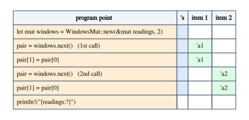

# Generic Associated Types and Lending Iterators

Chapter 2 ended with a promise. An iterator whose items borrow from data it
holds a reference to, like `slice::Iter<'a, T>` handing out `&'a T`, fits the
`Iterator` trait perfectly. An iterator whose items borrow from the *iterator
itself* does not fit at all, and no amount of annotation will make it fit. This
chapter keeps the promise: it shows exactly where `Iterator` falls short, and
what Rust offers instead.

Items that borrow from the iterator are not exotic. A line reader that reuses
one buffer for every line hands out string slices pointing into that buffer, and each
one is overwritten by the next call. An iterator over overlapping mutable windows
of a slice (`[0..2]`, `[1..3]`, ...) cannot let two windows exist at once,
because they share an element. In both cases the item is only valid until the
next call to `next`, and the type of the item has to say so. Saying so needs an
associated type that takes a lifetime parameter: a *generic associated type*, or
GAT.

GATs solve the problem, and they bring a few new rules with them: a `where`
clause the compiler insists on, `for` loops that stop working, and one real
limitation of the type system that shows up as soon as you write generic code
over a GAT. We will meet each of them with a program, and read what the compiler
says.

**In this chapter you will learn:**

- why `Iterator` cannot describe items that borrow from the iterator, and what
  the compiler says when you try;
- how a generic associated type, `type Item<'a> where Self: 'a`, describes them,
  and why the `where` clause is mandatory;
- how to implement a lending iterator (`WindowsMut` and a buffer-reusing line
  reader), consume it with `while let`, and why `for` loops and adapters do not
  apply;
- why a bound such as `for<'a> L::Item<'a>: Debug` turns into `L: 'static`, and
  two ways around this limitation;
- other uses of GATs, such as borrowing views, and when a lifetime parameter on
  the trait is the simpler design.

## The problem: items that borrow from the iterator

### What `Iterator::next` promises

Here is the heart of the `Iterator` trait, with the elided lifetime of `next`
written out (this is an expansion, not compiled code):

```rust,ignore
pub trait Iterator {
    type Item;

    fn next<'n>(&'n mut self) -> Option<Self::Item>;
}
```

The thread of this book applies directly: the signature is the contract. `next`
borrows the iterator for some region `'n` that the caller picks, a fresh one for
every call. The result has type `Self::Item`, and `Self::Item` is fixed by the
`impl`, once for the whole type, before any call happens. It cannot mention
`'n`, because `'n` is not in scope where `Item` is defined. So the contract
says: *the item you get does not depend on how long you borrowed the iterator.*

Callers rely on that contract all the time. They hold one item while asking for
the next (`let a = it.next(); let b = it.next();`), and adapters such as
`collect`, `zip`, `peekable` and `max_by` are built on it: `collect` keeps every
item alive at the same time, in a vector, long after the borrows that produced
them have ended.

When the items borrow from data the iterator merely *points to*, the contract is
easy to keep. `slice::Iter<'a, T>` holds a `&'a [T]` and returns `&'a T`: the
item borrows the slice, not the iterator, so `Item = &'a T` is a fine choice
(Chapter 2 shows how such an `impl` is written). The trouble starts when the item
would have to borrow from the iterator itself.

### Overlapping mutable windows

The standard library has `slice::windows`, an iterator over overlapping shared
windows, but no `windows_mut`. Its documentation explains why:

> Because the Iterator trait cannot represent the required lifetimes, there
> is no `windows_mut` analog to `windows`; `[0,1,2].windows_mut(2).collect()`
> would violate the rules of references (though a LendingIterator analog is
> possible).

Let us try anyway. `WindowsMut` holds the slice as a `&'s mut [T]` and hands out
windows of `size` elements, moving the start by one each time
(`code/compile_fail/ch10_iterator_windows.rs`):

```rust
{{#include ../../code/compile_fail/ch10_iterator_windows.rs:iterator_impl}}
```

The only lifetime available for the item is `'s`, the lifetime of the borrowed
slice, so we use it. The compiler rejects the body of `next`:

```text
{{#include ../../code/compile_fail/ch10_iterator_windows.stderr}}
```

Read it label by label:

- "lifetime `'s` defined here" is the lifetime in the `impl` header, which
  `Item` promised.
- "let's call the lifetime of this reference `'1`" is the elided lifetime of
  `&mut self`, the `'n` of our expansion. It has no name in the source, so rustc
  makes one up.
- "method was supposed to return data with lifetime `'s` but it is returning
  data with lifetime `'1`": `window` was obtained *through* `&'1 mut self`, so it
  can borrow the slice for `'1` at most.

The last point is the reborrowing rule of Chapter 5. From a `&'1 mut` reference
to a `&'s mut [T]` you can reborrow the slice mutably for `'1`, not for `'s`. If
you could get the full `'s` out, two calls to `next` would give you two `&'s mut`
references whose regions overlap, and the compiler would have no way to stop you
from keeping both.

That is not a technicality. With windows of two elements over `[0, 1, 2]`, the
first window is `[0, 1]` and the second is `[1, 2]`: both contain the element at
index 1. A `collect` into a `Vec<&mut [i32]>` would hold two mutable references
to the same element at the same time, which is exactly what aliasing XOR mutation
(Chapter 1) forbids. The compiler is right to reject the `impl`; the only
question is how to write a *correct* type for `next`.

### There is no name for the borrow

The item should have the lifetime of the `&mut self` borrow, so the next idea is
to write that lifetime with `'_`
(`code/compile_fail/ch10_item_anonymous.rs`):

```rust
{{#include ../../code/compile_fail/ch10_item_anonymous.rs:impl}}
```

```text
{{#include ../../code/compile_fail/ch10_item_anonymous.stderr}}
```

E0637 says that `'_` has nothing to stand for here. Chapter 6 explains that `'_`
is never a name for an existing lifetime: it asks for a fresh one, or for the
one elision picks, and in an associated type there is neither. The lifetime we
want belongs to each *call* of `next`, and `Item` is defined outside any call.
What we need is an `Item` that takes the lifetime as a parameter.

## Generic associated types

### An associated type with a lifetime parameter

A generic associated type is an associated type with generic parameters of its
own. Here is the lending iterator trait, as it appears in
`code/examples/ch10_windows_mut.rs`:

```rust
{{#include ../../code/examples/ch10_windows_mut.rs:trait}}
```

`type Item<'a>` is not one type but a family of types, one for each lifetime
`'a`: for `WindowsMut` we will define `Item<'a>` as `&'a mut [T]`. In `next`,
elision (Chapter 3) gives the `'_` of `Self::Item<'_>` the lifetime of
`&mut self`, the only input lifetime. Written out:

```rust,ignore
fn next<'n>(&'n mut self) -> Option<Self::Item<'n>>;
```

Compare it with `Iterator::next`. The lifetime `'n` is still picked by the
caller, fresh at every call, but now it appears in the result. The contract has
changed: *the item you get is valid for as long as you borrow the iterator, and
no longer.* While you hold the item, the iterator stays mutably borrowed, so you
cannot call `next` again. That is precisely the guarantee overlapping windows
need.

The name "lending iterator" describes this contract: the iterator *lends* you
each item, and you give it back before asking for the next. (You may also meet
the older name "streaming iterator" for the same idea.)

> [!NOTE]
> Generic associated types are stable since Rust 1.65 (November 2022). The
> announcement, "Generic associated types to be stable in Rust 1.65"
> (https://blog.rust-lang.org/2022/10/28/gats-stabilization/), uses the lending
> iterator as its main example. GATs can also take type parameters
> (`type Pointer<T>`); this book needs only lifetime parameters. The standard
> library has no lending iterator trait as of Rust 1.99, so programs that need
> one define it, as we do here.

### Why the compiler insists on `where Self: 'a`

The `where Self: 'a` clause on `Item` looks like noise. The program
`code/compile_fail/ch10_missing_bound.rs` leaves it out:

```rust
{{#include ../../code/compile_fail/ch10_missing_bound.rs:trait}}
```

and the compiler refuses the trait itself, before any `impl` exists:

```text
{{#include ../../code/compile_fail/ch10_missing_bound.stderr}}
```

This error has no code. Its parts:

- "missing required bound on `Item`": the declaration of the GAT is incomplete.
- "help: add the required where clause: `where Self: 'a`": the exact fix.
- "this bound is currently required to ensure that impls have maximum
  flexibility": the reason, which needs unpacking.
- The last note links to issue #87479, where the Rust project discusses whether
  the bound should one day be implied instead of written.

Start from what `next` already knows. Its parameter has type `&'n mut Self`, and
a reference type `&'n mut Self` is only well formed when `Self: 'n` (the implied
bounds of Chapter 1: the referent outlives the reference). So *every* use of
`Self::Item<'n>` inside `next` comes with the fact `Self: 'n` for free. The
compiler's rule, in the words of the stabilization announcement: "for methods
that use the GAT, any bounds that can be proven must also be present on the GAT
itself." Writing the bound on the GAT turns a fact that `next` happens to know
into a promise of the trait, that `Item<'a>` is only ever used for lifetimes `'a`
that `Self` outlives.

That promise is what gives implementations their flexibility. For
`Self = WindowsMut<'s, T>`, the bound `WindowsMut<'s, T>: 'a` unpacks into
`'s: 'a` and `T: 'a`: the window cannot outlive the slice it is cut from, and the
elements outlive the window. With those facts, `&'a mut [T]` is a well-formed
type. Without them, the implementation would have to define `Item<'a>` for every
lifetime, including lifetimes longer than `'s`, for which `&'a mut [T]` makes no
sense.

The rule looks at the methods that use the GAT. If the lifetime of the GAT comes
from some other input, no bound is implied and none is required. This trait
compiles as it is, without any `where` clause
(`code/examples/ch10_parse_gat.rs`):

```rust
{{#include ../../code/examples/ch10_parse_gat.rs:trait}}
```

```rust
{{#include ../../code/examples/ch10_parse_gat.rs:impls}}
```

```text
{{#include ../../code/output/ch10_parse_gat.txt}}
```

`Words` borrows from the input and `WordCount` borrows nothing, but neither
involves `Self`, so `Self: 'a` is not implied anywhere. (Notice also that the
`impl` for `WordCount` may write `parse` with elided lifetimes, because
`Output<'a>` does not mention `'a`.)

### Implementing the lending iterator

Here is `WindowsMut` again, now implementing `LendingIterator`:

```rust
{{#include ../../code/examples/ch10_windows_mut.rs:windows_mut}}
```

Three details deserve a comment.

- The `impl` repeats `where Self: 'a`. It is not decoration: the definition
  `Item<'a> = &'a mut [T]` is checked with the `impl`'s own `where` clauses, and
  without the clause nothing says that `T` outlives `'a`.
- `next` writes its return type as `Option<&mut [T]>`, not
  `Option<Self::Item<'_>>`. An `impl` may spell out the concrete type; the
  elided lifetime is the one of `&mut self`, as before.
- The body is the same as in the rejected `Iterator` version. Only the contract
  changed, and the body that broke the old contract keeps the new one.

If you forget the `where` clause in the `impl`, the compiler reports two errors
(`code/compile_fail/ch10_impl_without_where.rs`):

```rust
{{#include ../../code/compile_fail/ch10_impl_without_where.rs:impl}}
```

```text
{{#include ../../code/compile_fail/ch10_impl_without_where.stderr}}
```

E0477, "the type `WindowsMut<'s, T>` does not fulfill the required lifetime",
says that the `impl` cannot show `Self: 'a`, which the trait's definition of
`Item` requires, and its help suggests copying the `where` clause from the
trait. E0309, "the parameter type `T` may not live long enough", is the same
problem seen from inside the type: `&'a mut [T]` needs `T: 'a`, and without the
clause nothing provides it. Both disappear with `where Self: 'a`. For a type
without lifetime or type parameters, such as a struct that owns a `Vec<String>`,
`Self: 'a` holds for every `'a` and the `impl` may leave the clause out; you
will see one in *Borrowing views* below.

### Consuming a lending iterator with `while let`

Here is `WindowsMut` at work. A counter that should never decrease has some dips
in its readings, and we repair them by carrying the previous value forward, one
window of two readings at a time:

```rust
{{#include ../../code/examples/ch10_windows_mut.rs:consume}}
```

```text
{{#include ../../code/output/ch10_windows_mut.txt}}
```

Each repair is visible to the next window, because the windows overlap: after
`[5, 4]` became `[5, 5]`, the next window starts with that second 5. This is the
program the standard library's documentation says you cannot write with
`Iterator`.

Where are the regions? Each call to `windows.next()` borrows `windows` mutably
for a region we can call `'a1`, `'a2`, ..., and the item `pair` has type
`&'a1 mut [i32]`. The last use of `pair` is at the end of the loop body, so by
non-lexical lifetimes (Chapter 1) the borrow of `windows` ends there, and the
next iteration may borrow it again. All of these regions sit inside `'s`, the
region in which `windows` borrows `readings`, and `'s` ends after the loop, so
`println!` can read `readings` again.



The compiler enforces the "never overlap" part. Holding one item while asking
for the next (`code/compile_fail/ch10_two_items.rs`):

```rust
{{#include ../../code/compile_fail/ch10_two_items.rs:two_items}}
```

```text
{{#include ../../code/compile_fail/ch10_two_items.stderr}}
```

This is the ordinary E0499 of Chapter 1, and it reads naturally once you know
the signature of `next`: "first mutable borrow occurs here" is the first call,
whose result keeps `lender` borrowed; "second mutable borrow occurs here" is the
second call; "first borrow later used here" is the use of `first` that keeps the
first borrow alive. Notice that this function is generic: the compiler does not
know which lending iterator `L` is, and it does not need to. The signature of
`next` is enough to reject the code, for every possible `L`.

### Items that borrow the iterator's own buffer

Overlapping windows are one reason to lend. The other common reason is reuse:
an iterator that keeps its own buffer and hands out views into it. Here is a
reader that normalizes the lines of a text (lowercase, runs of whitespace
collapsed to one space) into a single `String` that it reuses for every line
(`code/examples/ch10_normalized_lines.rs`):

```rust
{{#include ../../code/examples/ch10_normalized_lines.rs:normalized_lines}}
```

The item borrows `self.buffer`, a field the iterator owns. With `Iterator`, the
item type would have to be `String`, and every line would allocate a new string;
here the loop allocates once, when the buffer first grows. The price is that an
item cannot outlive the iteration that produced it, so a caller that wants to
keep something must copy it:

```rust
{{#include ../../code/examples/ch10_normalized_lines.rs:main}}
```

```text
{{#include ../../code/output/ch10_normalized_lines.txt}}
```

Keeping the item itself instead of a copy is rejected, for the reason we just
saw (`code/compile_fail/ch10_keep_line.rs`, with a simpler `TrimmedLines`
lender):

```rust
{{#include ../../code/compile_fail/ch10_keep_line.rs:keep}}
```

```text
{{#include ../../code/compile_fail/ch10_keep_line.stderr}}
```

This E0499 has loop-specific labels. "`lines` was mutably borrowed here in the
previous iteration of the loop": the call to `next` in iteration one lent an item
that the vector still holds. "first borrow used here, in later iteration of
loop": `keys.push` uses the vector, and with it that first item, in iteration
two, while `next` wants to borrow `lines` again.

The same idea appears in the standard library in a different shape:
`BufRead::read_line` writes into a `String` that *you* pass in, so the buffer
belongs to the caller and no lending is needed. Lending moves the buffer into the
iterator.

### Why `for` loops and adapters do not apply

A `for` loop is sugar for a call to `IntoIterator::into_iter` followed by calls to
`Iterator::next`. A lending iterator implements neither trait
(`code/compile_fail/ch10_for_loop.rs`):

```rust
{{#include ../../code/compile_fail/ch10_for_loop.rs:for_loop}}
```

```text
{{#include ../../code/compile_fail/ch10_for_loop.stderr}}
```

E0277 says "`L` is not an iterator", with the note "required for `L` to
implement `IntoIterator`". The help, to add an `Iterator` bound, is the wrong
fix here: it would compile, and it would only accept types that are *also*
ordinary iterators, which `WindowsMut` cannot be. The honest way to loop is
`while let Some(item) = lender.next()`.

The adapters of `Iterator` are not available either, and some of them cannot
exist at all. `collect` keeps every item at once, which is exactly what a lending
iterator forbids. Others could be written as methods of `LendingIterator`, but
their closures must accept an item of *any* lifetime, because each call to
`next` lends for a different region. A `for_each` would need
`F: FnMut(Self::Item<'_>)`, which is `F: for<'a> FnMut(Self::Item<'a>)`, a
higher-ranked bound (Chapter 9). As the next section shows, a higher-ranked bound
over a GAT runs into a limitation of today's compiler. And a `map` whose closure
returns something borrowed from the item would need its output type to depend on
`'a` too, which a plain type parameter `B` cannot do.

## Generic code over a lending iterator

### A bound on every item

Suppose we want a function that prints every item of any lending iterator. The
items must be `Debug`, for every lifetime the iterator might lend them for, so
the natural bound is higher-ranked (`code/compile_fail/ch10_hrtb_static.rs`):

```rust
{{#include ../../code/compile_fail/ch10_hrtb_static.rs:print_all}}
```

The function compiles. Calling it with a `NormalizedLines` that reads a `String`
does not:

```rust
{{#include ../../code/compile_fail/ch10_hrtb_static.rs:caller}}
```

```text
{{#include ../../code/compile_fail/ch10_hrtb_static.stderr}}
```

The first labels are familiar from Chapter 1: `config` is borrowed by `lines`,
and dropped at the end of `caller` while still borrowed. The surprise is
"argument requires that `config` is borrowed for `'static`": nothing in
`print_all` mentions `'static`. The first note explains where it comes from, and
it is unusually candid: "due to a current limitation of the type system, this
implies a `'static` lifetime", pointing at `for<'a> L::Item<'a>: Debug`.

Here is the reasoning behind it. `for<'a>` means *every* lifetime, including
`'static` and lifetimes much longer than the borrow of `config`. But
`L::Item<'a>` is only defined when `L: 'a`, the `where` clause of the trait. For
the bound to be meaningful for every `'a`, the compiler requires `L: 'a` for
every `'a`, and a type that outlives every lifetime is a `'static` type. What we
meant was narrower: "for every `'a` such that `L: 'a`, the item is `Debug`". That
is a bound *on the binder*, `for<'a where L: 'a>`, and Chapter 9 (*The limits of
`for<..>`*) shows that Rust cannot express bounds on binders today. The
stabilization announcement of GATs lists this as one of the most limiting known
issues, and notes that fixing it needs compiler work that is not a short-term
project.

The error is conservative, not a sign of a bug in your code. When the lender
really is `'static`, the same `print_all` works. A `NormalizedLines` that reads
a string literal holds a `&'static str`, so it is a `'static` type
(`code/examples/ch10_print_all_static.rs`):

```rust
{{#include ../../code/examples/ch10_print_all_static.rs:main}}
```

```text
{{#include ../../code/output/ch10_print_all_static.txt}}
```

The `for_each` adapter from the previous section hits the same wall. As a
default method of the trait, it compiles; calling it on a `WindowsMut` over a
borrowed vector does not (`code/compile_fail/ch10_for_each_static.rs`):

```rust
{{#include ../../code/compile_fail/ch10_for_each_static.rs:for_each}}
```

```rust
{{#include ../../code/compile_fail/ch10_for_each_static.rs:caller}}
```

```text
{{#include ../../code/compile_fail/ch10_for_each_static.stderr}}
```

This time the borrow comes in through a parameter, so the error is E0521,
"borrowed data escapes outside of function" (Chapter 7 reads it in detail), but
the note is the same: the `'static` requirement comes from the higher-ranked
bound `FnMut(Self::Item<'_>)`. Every generic function whose bound quantifies over
the lifetime of a GAT has this problem. There are two ways around it.

### Workaround 1: put the bound in the trait

If every item of every lending iterator you care about should be `Debug`, say so
in the trait, on the GAT itself (`code/examples/ch10_bound_in_trait.rs`):

```rust
{{#include ../../code/examples/ch10_bound_in_trait.rs:trait}}
```

Generic code then needs no bound at all, because the trait guarantees it:

```rust
{{#include ../../code/examples/ch10_bound_in_trait.rs:print_all}}
```

```rust
{{#include ../../code/examples/ch10_bound_in_trait.rs:main}}
```

```text
{{#include ../../code/output/ch10_bound_in_trait.txt}}
```

The bound `Item<'a>: Debug` is checked once per `impl`, for the lifetimes the
`impl` actually defines (those with `Self: 'a`), so no higher-ranked bound and no
`'static` requirement appears. The `impl` pays for it: `WindowsMut` can only
implement the trait when its items are `Debug`.

```rust
{{#include ../../code/examples/ch10_bound_in_trait.rs:impl}}
```

This workaround is the right one when the bound is part of what the trait
*means*. The standard library uses it: the trait behind async closures,
`AsyncFnMut`, declares `type CallRefFuture<'a>: Future<Output = Self::Output>
where Self: 'a;`, a GAT whose every instance must be a future (Chapter 11). It is
the wrong one when different callers need different bounds: you cannot add a
`Display` requirement for one function without imposing it on every
implementation.

### Workaround 2: a helper trait

The second workaround avoids the GAT. It comes from Sabrina Jewson's article
"The Better Alternative to Lifetime GATs"
(https://sabrinajewson.org/blog/the-better-alternative-to-lifetime-gats), and it
moves the lifetime from the associated type to a *trait*
(`code/examples/ch10_helper_trait.rs`):

```rust
{{#include ../../code/examples/ch10_helper_trait.rs:traits}}
```

Read it in two steps.

1. `LendingIteratorLifetime<'this>` is an ordinary trait with an ordinary
   associated type: for one lifetime `'this`, it says what the item is.
   `LendingIterator` requires it for every lifetime, with the higher-ranked
   supertrait `for<'this> LendingIteratorLifetime<'this>`, and `next` returns
   the item for the lifetime of its `&mut self`.
2. The second parameter, `ImplicitBounds`, is never written by anyone. Its
   default, `Bounds<&'this Self>`, mentions the type `&'this Self`, and a type
   that appears in a trait reference brings its implied bounds along. Wherever
   `LendingIteratorLifetime<'this>` is used, including inside the
   `for<'this>`, `&'this Self` must be well formed, so `Self: 'this` holds.

The second step is what defeats the limitation. In effect, the implied bound
restricts the `for<'this>` to the lifetimes that `Self` outlives, which is
exactly the "bound on the binder" that we could not write. More concretely: an
implementation never has to state `Self: 'this` as a `where` clause, so there is
no clause that the compiler would have to prove "for every lifetime". The
private module makes `Sealed` and `Bounds` impossible to name from outside, so no
one can override the default.

The implementations look like this:

```rust
{{#include ../../code/examples/ch10_helper_trait.rs:impls}}
```

There is no `where` clause to repeat. The `impl` of `LendingIteratorLifetime`
gets `WindowsMut<'s, T>: 'this`, hence `T: 'this`, as an implied bound of its
header, so `&'this mut [T]` is well formed for every lifetime it covers. Generic
code names the item as `<L as LendingIteratorLifetime<'a>>::Item`, and both the
printing function and a `for_each` now work with borrowed data:

```rust
{{#include ../../code/examples/ch10_helper_trait.rs:generic}}
```

```rust
{{#include ../../code/examples/ch10_helper_trait.rs:main}}
```

```text
{{#include ../../code/output/ch10_helper_trait.txt}}
```

The defaulted parameter is not an ornament. Remove it, and the `impl` has no
implied bound to stand on (`code/compile_fail/ch10_helper_without_bounds.rs`):

```rust
{{#include ../../code/compile_fail/ch10_helper_without_bounds.rs:traits}}
```

```text
{{#include ../../code/compile_fail/ch10_helper_without_bounds.stderr}}
```

E0309 says that `&'this mut [T]` might outlive the data it points at, because
nothing relates `T` to `'this`. The suggested fix, `T: 'this`, is an explicit
`where` clause on the `impl`, and an explicit clause is exactly what makes a
`for<'this>` bound demand `'static` again, as the GAT's clause did. The implied
bound is the whole trick.

Here are the three designs side by side:

| Design | Borrowing lenders in generic code | Bounds chosen by | Cost |
|---|---|---|---|
| GAT + `for<'a>` bound | no: forces `'static` | each function | none, until it fails |
| Bound on the GAT | yes | the trait, for everyone | every `impl` must satisfy it |
| Helper trait | yes | each function | more syntax, longer error messages |

## Other uses of GATs

### Borrowing views

Lending iterators are the famous example, but the general pattern is broader: a
method that returns *something that may borrow from `self`*, where different
implementations borrow differently, or not at all. Here is a source of
configuration values (`code/examples/ch10_views.rs`):

```rust
{{#include ../../code/examples/ch10_views.rs:trait}}
```

A source that parsed a file owns the strings, and can lend a `&str` pointing
into them:

```rust
{{#include ../../code/examples/ch10_views.rs:file_source}}
```

A source of computed defaults has nothing to lend, and returns owned strings;
its `Value<'a>` simply ignores `'a`:

```rust
{{#include ../../code/examples/ch10_views.rs:computed_source}}
```

Neither `impl` repeats `where Self: 'a`: `FileSource` and `Defaults` have no
lifetime or type parameters, so they outlive every `'a` and the bound holds
trivially. Generic code accepts both kinds of source:

```rust
{{#include ../../code/examples/ch10_views.rs:generic}}
```

```rust
{{#include ../../code/examples/ch10_views.rs:main}}
```

```text
{{#include ../../code/output/ch10_views.txt}}
```

Compare the alternatives without a GAT. A trait method returning `&str` cannot
be implemented by `Defaults`, which has no string to point to. A method returning
`String` forces `FileSource` to allocate on every lookup. A method returning
`Cow<'_, str>` (Chapter 14) works, at the cost of a runtime check of which variant
you got; the GAT moves that choice to compile time, one choice per
implementation. Notice also that `lookup` needed no higher-ranked bound: the
`AsRef<str>` requirement sits on the GAT itself, which is workaround 1 used by
design.

### When a lifetime parameter on the trait is simpler

A GAT ties an item to the borrow of `self`. That is exactly right when the item
really borrows from `self`, and needlessly strict when it does not. Before
reaching for a GAT, ask: *does the item borrow from the iterator, or from
something the iterator borrows?*

A tokenizer over a `&'src str` returns tokens that point into the text, not into
the tokenizer. Its trait can carry the lifetime of the text as a parameter
(`code/examples/ch10_tokens.rs`):

```rust
{{#include ../../code/examples/ch10_tokens.rs:trait}}
```

Generic code can then keep every token, because a token does not keep the
tokenizer borrowed:

```rust
{{#include ../../code/examples/ch10_tokens.rs:collect_all}}
```

```text
{{#include ../../code/output/ch10_tokens.txt}}
```

With `LendingIterator` instead, `collect_all` would be the E0499 program of
*Consuming a lending iterator with `while let`*: each token would hold the
tokenizer borrowed until the next call. (For this particular case,
`Iterator<Item = &'src str>` works just as well; Chapter 2 builds such an
iterator. A trait like `Tokens<'src>` is useful when the trait has other
methods, or is not an iterator at all.) The lifetime parameter has a cost of its
own: generic code that creates the data itself must bound the trait for every
lifetime, `for<'src> Tokens<'src>`, as with `for<'de> Deserialize<'de>` in
Chapter 9.

A rule of thumb for the three designs:

| The item borrows from ... | Design |
|---|---|
| data the type holds a reference to, for `'s` | `Iterator<Item = &'s T>`, or a trait parameter `'s` |
| the type itself, differently on each call | a GAT, `type Item<'a> where Self: 'a` |
| an input of the method other than `self` | a GAT without `where`, or a trait parameter |
| nothing | a plain associated type |

## Common confusions

- **"`where Self: 'a` makes the item live as long as the iterator."** It does the
  opposite: it restricts `'a` to lifetimes that `Self` outlives. The item lives
  at most as long as the borrow of the iterator, never longer.
- **"I can make it work with `for` by implementing `IntoIterator`."**
  `IntoIterator` produces an `Iterator`, whose items cannot borrow from it. Use
  `while let`.
- **"The `'static` requirement means my code would be unsound."** No. The note
  says "current limitation of the type system": the compiler cannot express the
  bound you meant, so it demands a stronger one. Use one of the two workarounds,
  or a `'static` lender.
- **"The `where` clause in the `impl` is optional, since the trait has it."**
  For a type with lifetime or type parameters it is required (E0477, E0309); for
  a type without parameters it may be omitted.
- **"GATs replace lifetime parameters on traits."** They answer a different
  question. If the items borrow from data with a lifetime the type already has,
  a plain associated type or a trait parameter is simpler and lets callers keep
  items.
- **"`windows_mut` is missing from the standard library by oversight."** It is
  missing because `Iterator` cannot express it. For `Copy` elements,
  `Cell::from_mut` and `as_slice_of_cells` together with `windows` give an
  alternative (see the exercises).

## Summary

- `Iterator::Item` is chosen once per type and cannot mention the borrow of
  `&mut self` made by each call to `next`, so an iterator cannot hand out items
  that borrow from itself. Trying gives "lifetime may not live long enough"
  (method "was supposed to return data with lifetime `'s`").
- A generic associated type, `type Item<'a> where Self: 'a`, lets the item depend
  on the borrow: `fn next(&mut self) -> Option<Self::Item<'_>>`. GATs are stable
  since Rust 1.65.
- The compiler requires `where Self: 'a` ("missing required bound on `Item`")
  because `&'a mut self` already implies it; the bound tells implementations that
  `'a` never outlives `Self`. Implementations of types with parameters repeat it.
- A lending iterator is consumed with `while let`; two items cannot be alive at
  once (E0499); `for` loops (E0277) and `collect` do not apply, and closures for
  adapters need higher-ranked bounds.
- A bound like `for<'a> L::Item<'a>: Debug`, or an adapter taking
  `FnMut(Self::Item<'_>)`, forces `L: 'static` "due to a current limitation of
  the type system". Workarounds: put the bound on the GAT, or use a helper trait
  with a defaulted `Bounds<&'this Self>` parameter whose implied bound restricts
  the `for<'this>`.
- GATs also describe borrowing views (`type Value<'a>`) that some implementations
  lend and others own. When items borrow from data rather than from `self`, a
  plain associated type or a lifetime parameter on the trait is simpler.

## Exercises

1. **A numbered line reader.** Write a lending iterator `NumberedLines<'src>`
   whose items are string slices of the form `"3: text of the third line"`, built in a
   reused buffer. Use it with `while let` to print a short text, and check that
   the buffer's capacity stops growing after the longest line.
   *Hint:* `use std::fmt::Write;` lets you `write!(self.buffer, "{n}: {line}")`
   into a `String`; `String::capacity` reports the allocation.

2. **Overlapping windows without a lending iterator.** Repair the counter
   readings of `ch10_windows_mut.rs` without `WindowsMut`, using only
   `slice::windows`.
   *Hint:* `Cell::from_mut(&mut readings[..]).as_slice_of_cells()` turns a
   `&mut [i32]` into a `&[Cell<i32>]`, and shared windows over cells can still
   be written through `Cell::set`. Which property of `i32` does `Cell::get`
   rely on?

3. **A `count_if` that works with borrowed data.** Using the helper-trait design
   of `ch10_helper_trait.rs`, write
   `fn count_if<L, P>(lender: L, predicate: P) -> usize` that counts the items
   for which `predicate` returns `true`, and call it on a `WindowsMut` over a
   local vector. Then write the same function for the GAT design of
   `ch10_windows_mut.rs`, call it the same way, and read the error.
   *Hint:* the predicate needs a bound like
   `P: for<'a> FnMut(&<L as LendingIteratorLifetime<'a>>::Item) -> bool`.

4. **Make the error go away, wrongly.** Change only the *caller* in
   `ch10_hrtb_static.rs` so that it compiles, without touching `print_all` or
   the trait. Then explain why this is not a real fix for a program that reads its
   configuration from a file at run time.
   *Hint:* the lender must be `'static`; Chapter 7 lists the ways to get a
   `&'static str`, and one of them works for data created at run time.

5. **A GAT where it does not belong.** Rewrite `Tokens<'src>` from
   `ch10_tokens.rs` as a `LendingIterator` with `type Item<'a> = &'a str where
   Self: 'a`, keep `collect_all`, and read the error. Which design would you
   choose for a tokenizer, and why?
   *Hint:* the item type now mentions the borrow of the tokenizer, not `'src`.
