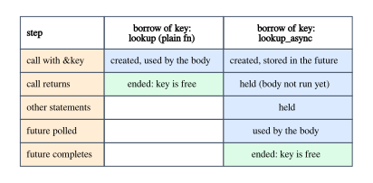

# Lifetimes in Async Code

An `async fn` looks like a function, but calling it does not run its body. The
call returns a *future*: a value that holds the arguments and the state of the
body, and that runs the body, piece by piece, when something polls it. That one
fact explains most lifetime errors in async code. A future is a value like any
other, and a value that holds a borrow is constrained by that borrow for as long
as the value exists. The borrow does not end when the call returns; it ends when
the future is done.

Everything else follows. A future that borrows a local cannot be handed to an
executor that may poll it later, which is why `spawn` asks for `'static`. Async
callbacks need a way to say "the future may borrow my argument", which plain `Fn`
bounds cannot say (Chapter 9) and `AsyncFn` can. And a future that keeps a
reference to one of its own locals across an `.await` points into itself, which
is why futures are polled through `Pin`.

This chapter works through these consequences with programs that use only the
standard library: no async runtime, just a ten-line `block_on` and a toy
executor whose `spawn` has the same signature as the real ones.

**In this chapter you will learn:**

- what the future returned by an `async fn` captures, and why it holds its
  borrows until it completes;
- how to run futures with the standard library alone (`block_on` with
  `Waker::noop`);
- why executors require `F: Future + Send + 'static`, what the errors look like
  when a spawned future borrows, and how to fix them;
- why scoped tasks are hard in async code while `thread::scope` works: futures
  can be forgotten;
- how `AsyncFn` and `AsyncFnMut` let async callbacks borrow their arguments and
  their captured state;
- why self-referential futures need `Pin`, just enough to read the messages;
- what `async fn` in traits captures, and how to require `Send` futures.

## What an `async fn` returns

### A future that captures every input lifetime

Here are two functions that look up a key in a configuration map, one plain and
one async (`code/examples/ch11_async_captures.rs`):

```rust
{{#include ../../code/examples/ch11_async_captures.rs:lookup}}
```

The signatures look alike, and the bodies are the same apart from a `println!`
that will show us *when* the body runs. But `lookup_async` does not return an
`Option<&'a str>`. It returns a future whose output is an `Option<&'a str>`, and
the compiler reads its signature roughly as follows. The program contains this
"desugared" version too, and it behaves the same:

```rust
{{#include ../../code/examples/ch11_async_captures.rs:desugared}}
```

The return type is an opaque `impl Future` (Chapter 8), and the important part
is `use<'a, 'k>`: the future captures *both* input lifetimes. The `async move`
block stores `config` and `key` inside the future, because the body has not run
yet and will need them later. The output type mentions only `'a`, but the future
itself holds a `&'k str`. An `async fn` always captures all of its input
lifetimes; the explicit `use<'a, 'k>` here just says so.

Nothing runs at the call. Watch the order of the output:

```rust
{{#include ../../code/examples/ch11_async_captures.rs:lazy}}
```

```text
{{#include ../../code/output/ch11_async_captures.txt}}
```

The first line is printed before the body of `lookup_async` starts, because the
body runs only when `block_on` polls the future. (The last two lines come from
code shown later in this chapter.)

### The borrow lasts until the future completes

A future that holds a borrow is a value that holds a borrow, so the ordinary
rules of Chapter 1 apply to it, with the future's whole existence as the region
(`code/compile_fail/ch11_future_holds_borrow.rs`):

```rust
{{#include ../../code/compile_fail/ch11_future_holds_borrow.rs:holds}}
```

```text
{{#include ../../code/compile_fail/ch11_future_holds_borrow.stderr}}
```

The labels tell the story in order: "immutable borrow occurs here" is the call,
which stores `&text` in the future; "mutable borrow occurs here" is the
`push_str`; "immutable borrow later used here" is `block_on(future)`, where the
future, and the borrow inside it, is still alive. With a synchronous
`count_words`, the borrow would have ended when the call returned, and the same
three lines would compile.

The difference is sharper for the second argument of `lookup_async`. With the
plain `lookup`, `key` may die right after the call: the result borrows only
`config`. This compiles:

```rust
{{#include ../../code/examples/ch11_async_captures.rs:scoped_key}}
```

(`lookup_eager` is explained in a moment.) The same block with `lookup_async`
does not (`code/compile_fail/ch11_future_outlives_key.rs`):

```rust
{{#include ../../code/compile_fail/ch11_future_outlives_key.rs:caller}}
```

```text
{{#include ../../code/compile_fail/ch11_future_outlives_key.stderr}}
```

Read the labels from the bottom up. "`key` dropped here while still borrowed" is
the end of the inner block. "borrowed value does not live long enough" points at
`&key`. And "borrow later stored here" points at `future`: the borrow of `key` is
*stored* in the future, which outlives the block. The output type
`Option<&'a str>` has nothing to do with it; what matters is what the future
captures.



There are two fixes. The usual one is to await the future while its arguments
are alive, which is what `lookup_async(&config, &key).await` written in one
expression does. The other is to do the borrowing work *before* creating the
future, and capture only what the future needs:

```rust
{{#include ../../code/examples/ch11_async_captures.rs:eager}}
```

`lookup_eager` is a plain function that returns a future. Its body runs at the
call, uses `key`, and builds an `async move` block that holds only `value`, an
`Option<&'a str>`. The `use<'a>` bound promises that the future captures `'a`
and nothing else, and the compiler checks the promise against the async block.
This is the pattern to reach for when an API should take an argument by reference
but must not hold on to it.

### Returning a future that borrows a local

A function can return a future that borrows its *parameters*, as `lookup_async`
does. It cannot return a future that borrows its *locals*, for the same reason it
cannot return a reference to one (Chapter 5)
(`code/compile_fail/ch11_return_borrowing_future.rs`):

```rust
{{#include ../../code/compile_fail/ch11_return_borrowing_future.rs:make}}
```

```text
{{#include ../../code/compile_fail/ch11_return_borrowing_future.stderr}}
```

The message asks for `'static` because the function has no lifetime parameters:
its opaque return type can capture none, so the future it returns may not hold
any borrow that can expire. The fix is to let the future *own* the data, and lend
it from inside:

```rust
{{#include ../../code/examples/ch11_async_captures.rs:owned}}
```

The `async move` block owns `text`, and `count_words(&text)` borrows it from
inside the block. That borrow lives inside the future, next to the data it
points to, so it never escapes. We will come back to this "future that borrows
from itself" in the section on `Pin`.

## Running futures with the standard library

To run a future you need an executor, and the standard library does not include
one. For this book's examples a minimal one is enough:

```rust
{{#include ../../code/examples/ch11_async_captures.rs:block_on}}
```

Line by line:

- `Future::poll` takes `self: Pin<&mut Self>` and a `&mut Context<'_>`, and
  returns `Poll::Ready(output)` or `Poll::Pending`.
- `pin!` (stable since 1.68) pins the future in the current stack frame and gives
  us a `Pin<&mut F>`; `as_mut` reborrows it for each call to `poll`.
- A `Context` carries a `Waker`, which a pending future uses to say "poll me
  again, I can make progress now". `Waker::noop()` returns a waker that does
  nothing.
- The loop polls until the future is ready.

A real executor parks the thread after `Poll::Pending` and wakes it up when the
future calls its waker. Ours simply polls again, which is wasteful but correct
for futures that never wait for anything outside the program, as is the case
for every future in this chapter. Chapter 9 used the same `block_on`.

> [!NOTE]
> `Waker::noop` is stable since Rust 1.85, like async closures and the
> `AsyncFn` traits. With an older compiler, `block_on` needs a hand-written
> waker instead.

## Spawning: why executors require `'static`

### A toy executor

`block_on` runs one future and waits for it. An executor also lets you *spawn*
tasks: futures that it keeps and polls later, concurrently with other tasks.
Here is a toy one (`code/examples/ch11_toy_executor.rs`). First, a future that
gives the other tasks a turn, by being pending once:

```rust
{{#include ../../code/examples/ch11_toy_executor.rs:yield_now}}
```

Then the executor. Its `spawn` has the same bounds as the `spawn` of
multi-threaded executors:

```rust
{{#include ../../code/examples/ch11_toy_executor.rs:executor}}
```

`spawn` boxes the future and stores it in a vector; `run` polls each stored task
in turn until all of them are done. The type of a stored task,
`Pin<Box<dyn Future<Output = ()> + Send + 'static>>`, explains the bounds on
`spawn`: the vector can hold futures of different types only as trait objects,
and a trait object in a `Box` that is kept for an unknown time needs an explicit
or default lifetime bound (Chapter 8 explains why `Box<dyn Trait>` defaults to
`'static`). Our executor runs on one thread, so `Send` is not strictly needed,
but a work-stealing executor moves tasks between worker threads, and the toy
keeps the real signature to reproduce the real errors. For comparison, tokio's
`spawn` is declared as follows (https://docs.rs/tokio/latest/tokio/task/fn.spawn.html,
checked for tokio 1.53):

```rust,ignore
pub fn spawn<F>(future: F) -> JoinHandle<F::Output>
where
    F: Future + Send + 'static,
    F::Output: Send + 'static,
```

Here are two tasks that count the words of the same configuration text,
yielding after each word:

```rust
{{#include ../../code/examples/ch11_toy_executor.rs:count_words}}
```

```rust
{{#include ../../code/examples/ch11_toy_executor.rs:spawn}}
```

```text
{{#include ../../code/output/ch11_toy_executor.txt}}
```

The tasks interleave: each yield lets the other task run. Each task owns an
`Arc<str>` handle to the text, so its type holds no borrow that can expire, and
it is `'static` (Chapter 7, *`T: 'static` does not mean "lives forever"*). Inside
the task, `count_words(label, &config)` borrows that handle freely: the borrow
lives inside the task.

Why `'static`? Because of what `spawn`'s signature cannot know. After `spawn`
returns, the executor holds the task and polls it whenever it likes, possibly
long after the function that spawned it has returned and its locals have been
freed. A borrow of a local would have to last for a region the signature cannot
name, so the signature demands the only region that is long enough for any
schedule: all of it. It is the same reasoning as for `thread::spawn` in
Chapter 7, and the errors are the same too.

### An async block that borrows a local

The first attempt spawns an async block that uses a local string
(`code/compile_fail/ch11_spawn_borrow_block.rs`, with the same `Executor`):

```rust
{{#include ../../code/compile_fail/ch11_spawn_borrow_block.rs:spawn}}
```

```text
{{#include ../../code/compile_fail/ch11_spawn_borrow_block.stderr}}
```

E0373 is the error Chapter 7 shows for a thread's closure, here for an async
block: "async block may outlive the current function, but it borrows `config`".
The note adds the async-specific reason, "async blocks are not executed
immediately", and the help is right: with `async move`, the block owns `config`
and borrows it from inside, exactly like the tasks of our example.

### A call to an `async fn`

The second attempt spawns the future of an `async fn` call directly; this file
uses a free function `spawn` with the same bounds, which drops the task instead
of storing it (`code/compile_fail/ch11_spawn_borrow_call.rs`):

```rust
{{#include ../../code/compile_fail/ch11_spawn_borrow_call.rs:spawn}}
```

```text
{{#include ../../code/compile_fail/ch11_spawn_borrow_call.stderr}}
```

There is no block here to add `move` to: `report(&config)` is a future that
captured `&config` at the call. The labels name the requirement ("argument
requires that `config` is borrowed for `'static`") and the note shows where it
comes from: the `'static` in `spawn`'s bound. The fix is to give the task its own
data, for example `spawn(async move { report(&config).await })`, which moves the
`String` into the task and lends it to `report` from inside.

### `async move` with a reference

Moving helps only if what you move is owned. When the function receives the data
by reference, `async move` moves the reference
(`code/compile_fail/ch11_spawn_ref_param.rs`):

```rust
{{#include ../../code/compile_fail/ch11_spawn_ref_param.rs:spawn}}
```

```text
{{#include ../../code/compile_fail/ch11_spawn_ref_param.stderr}}
```

E0521, "borrowed data escapes outside of function", is read label by label in
Chapter 7. "`config` escapes the function body here" points at the whole call to
`spawn`, and "argument requires that `'1` must outlive `'static`" is the
requirement no caller-chosen lifetime can meet. The fixes are the ones for
threads: take an owned parameter (`String`, `Arc<str>`), or clone the data into
the task before spawning.

### Not `Send`: what a future holds across `.await`

The other half of the bound is `Send`, and its error is worth seeing once,
because it is phrased in terms of what the future *holds*
(`code/compile_fail/ch11_spawn_not_send.rs`):

```rust
{{#include ../../code/compile_fail/ch11_spawn_not_send.rs:spawn}}
```

```text
{{#include ../../code/compile_fail/ch11_spawn_not_send.stderr}}
```

An async block is `Send` when everything it holds *across an `.await`* is `Send`,
because those are the values stored in the future while it is suspended. The
note "future is not `Send` as this value is used across an await" points at the
`.await` and at `shared`, an `Rc`, which is not `Send`. The same message appears
for a `MutexGuard` held across an `.await`. Either use a `Send` type (`Arc`
instead of `Rc`), or end the value's life before the `.await`, for example in an
inner block.

## Why scoped tasks are hard

Chapter 7 showed the threads version of the borrowing problem and its scoped
solution: threads spawned inside `thread::scope` may borrow locals, because
`thread::scope` does not return until every one of them has been joined. The
join happens inside the body of `thread::scope`, so no caller can skip it
(Chapter 13 tells why the API takes a closure instead of returning a guard).

An async version would have to be an `async fn`, or a function returning a
future: the scope waits for its tasks *by being polled* until they are done. And
a future is a value that the caller can stop polling at any point, then drop or
forget. Forgetting is safe in Rust, and a forgotten future never runs its
destructors (`code/examples/ch11_forget_future.rs`):

```rust
{{#include ../../code/examples/ch11_forget_future.rs:session}}
```

```rust
{{#include ../../code/examples/ch11_forget_future.rs:main}}
```

```text
{{#include ../../code/output/ch11_forget_future.txt}}
```

Both futures were polled once and suspended at the `.await`, holding a
`Connection`. Dropping the first one ran the destructors of everything it held:
"closing dropped". The second one was forgotten: its connection is never closed,
and nothing reports it.

Now imagine an async scope that spawns tasks on a multi-threaded executor, lets
them borrow the caller's locals, and relies on its destructor to cancel or await
them if it is dropped early. The caller polls the scope once, so the tasks start
and borrow the locals; then it forgets the scope future and returns. The locals
are freed, the destructor never runs, and the tasks, still owned by the executor,
keep running on other threads with dangling references. Safe code could cause a
use-after-free, so such an API would be unsound. This is why async APIs that let
spawned tasks borrow have to give something up: they block the thread until the
tasks finish (and stop being async), or they are `unsafe` to call, or they do not
let the tasks borrow at all, which is the `'static` bound.

Concurrency *inside one task* has no such problem. A `join` that polls two
futures in turn can take futures that borrow locals
(`code/examples/ch11_join_borrows.rs`):

```rust
{{#include ../../code/examples/ch11_join_borrows.rs:join}}
```

```rust
{{#include ../../code/examples/ch11_join_borrows.rs:main}}
```

```text
{{#include ../../code/output/ch11_join_borrows.txt}}
```

`join`'s signature has no `'static`: `A` and `B` may borrow anything that
outlives the call. This is sound even though the join future could be
forgotten, and the reason is ownership. The two child futures live *inside* the
join future. If someone forgets it, the children are forgotten with it, and
nobody can ever poll them again, so their borrows are never used again either. A
spawned task is different: the executor owns it and keeps polling it, whatever
happens to the code that spawned it.

## Async callbacks: `AsyncFn` and async closures

Chapter 9 (*Async callbacks that borrow*) showed that `F: Fn(&str) -> Fut` cannot
describe a callback whose future borrows its argument: `Fut` is one type, picked
by the caller, and it cannot depend on the lifetime of each argument. Rust 1.85
solved this with the `AsyncFn` family of traits and async closures. Here we look
at the other borrow an async callback often needs: a borrow of its own captured
state.

A callback that records every line it sees mutates a captured vector. With an
`FnMut` that returns a future, the future would have to borrow that vector
(`code/compile_fail/ch11_fnmut_future_capture.rs`; the callback takes an owned
`String` so that only the new problem shows):

```rust
{{#include ../../code/compile_fail/ch11_fnmut_future_capture.rs:for_each_line}}
```

```text
{{#include ../../code/compile_fail/ch11_fnmut_future_capture.stderr}}
```

This error has no code. Its labels: "variable captured here" is the use of `seen`
inside the async block; "inferred to be a `FnMut` closure" says which trait the
closure implements; "returns an `async` block that contains a reference to a
captured variable, which then escapes the closure body" is the problem. The two
notes give the rule: an `FnMut` closure has access to its captured variables only
while it is executing, so whatever it returns cannot borrow them.

The rule comes from the signature of `FnMut`. Its method is
`call_mut(&mut self, args) -> Self::Output`, and `Output` is one type for the
closure, unrelated to the borrow of `&mut self`. That is exactly the shape of
`Iterator::next` from Chapter 10, and it fails for the same reason: the result
cannot borrow from the thing being called. The fix is also the same. In the
standard library's source, `AsyncFnMut` is declared with a generic associated
type (simplified here; these items are unstable to name or call directly, and you
use them through the `AsyncFnMut(..)` sugar):

```rust,ignore
pub trait AsyncFnMut<Args: Tuple>: AsyncFnOnce<Args> {
    type CallRefFuture<'a>: Future<Output = Self::Output>
    where
        Self: 'a;

    extern "rust-call" fn async_call_mut(&mut self, args: Args)
        -> Self::CallRefFuture<'_>;
}
```

`CallRefFuture<'a>` is the lending pattern of Chapter 10: the future may borrow
the closure for as long as `&mut self` lasts. And the trait is used through a
higher-ranked bound, `AsyncFnMut(&str)`, so the future may borrow the argument
too. Both borrows at once (`code/examples/ch11_async_fn_mut.rs`):

```rust
{{#include ../../code/examples/ch11_async_fn_mut.rs:for_each_line}}
```

```rust
{{#include ../../code/examples/ch11_async_fn_mut.rs:main}}
```

```text
{{#include ../../code/output/ch11_async_fn_mut.txt}}
```

The async closure `async |line: &str| { ... }` keeps `line` across an `.await`
(a borrow of the argument) and pushes into `seen` (a mutable borrow of its
captured state). Each call returns a future that borrows both, and
`for_each_line` awaits it before calling the closure again, which is exactly what
the lending signature allows. `AsyncFn` (calls through `&self`) and `AsyncFnOnce`
(calls by value, once) complete the family, mirroring `Fn` and `FnOnce`.

## Self-referential futures and `Pin`

The tasks of our toy executor did something that safe Rust does not let you do
by hand: they borrowed from themselves. `async move { count_words(label,
&config).await }` stores `config` in the future, then creates the future of
`count_words`, which holds `&config`, a pointer to another part of the same
future. Here is a smaller case (`code/examples/ch11_self_ref_future.rs`):

```rust
{{#include ../../code/examples/ch11_self_ref_future.rs:self_ref}}
```

```text
{{#include ../../code/output/ch11_self_ref_future.txt}}
```

`keys` and `first` are both used after the `.await`, so both are stored in the
future while it is suspended, and `first` points at `keys`, *inside the same
value*. If the future were moved to another address after that point, `first`
would still point to the old address. Chapter 13 shows why you cannot write such a
struct yourself in safe Rust; the compiler writes it for you in every async block
that borrows across an `.await`, and protects it with `Pin`.

The protection is in the signature of `poll`: it takes `self: Pin<&mut Self>`.
A `Pin<&mut F>` is a mutable reference with an extra promise: the `F` it points
to will not be moved again until it is dropped (unless `F` implements `Unpin`,
which says that moving it is harmless). Before the first poll, no reference into
the future exists yet, which is why pushing the future into a vector and popping
it out was fine. `block_on` pins it with `pin!` before polling, and the toy
executor with `Box::pin`; from then on it stays where it is.

If you try to poll a future without pinning it, the compiler stops you
(`code/compile_fail/ch11_not_unpin.rs`):

```rust
{{#include ../../code/compile_fail/ch11_not_unpin.rs:poll_once}}
```

```rust
{{#include ../../code/compile_fail/ch11_not_unpin.rs:caller}}
```

```text
{{#include ../../code/compile_fail/ch11_not_unpin.stderr}}
```

`poll_once` accepts only `Unpin` futures, because `Pin::new` can pin a plain
`&mut F` only when moving `F` is harmless. The async block is not `Unpin`
("cannot be unpinned"), and the notes give the two ways to pin it: `pin!`, which
pins in the current stack frame, or `Box::pin`, which pins on the heap. The
second note is a lifetime remark in disguise: a `Pin<&mut F>` made by `pin!` is a
borrow of a local, so it cannot leave the current function; "if you need to
access the pinned value outside of the current scope", the box owns it instead.

That is as much `Pin` as lifetimes require. `Pin` does not make it safe to build
self-referential structs by hand; it is the promise that lets the compiler-built
ones work.

## `async fn` in traits

### What the returned future captures

Since Rust 1.75, traits may declare `async fn` methods. Such a method returns an
anonymous future type, one per implementation, which captures every input
lifetime and the trait's generic parameters, including `Self` (Chapter 8
explains these captures for `impl Trait` in traits). For

```rust
{{#include ../../code/compile_fail/ch11_trait_future_not_send.rs:trait}}
```

the future returned by `fetch` borrows `self` and `key` until it completes,
exactly like `lookup_async` at the start of this chapter. The lifetime rules hold
no surprises. The trouble is `Send`.

### `Send` bounds on the returned future

A generic function that spawns the future of `fetch` must know that it is
`Send`, and the trait does not say
(`code/compile_fail/ch11_trait_future_not_send.rs`):

```rust
{{#include ../../code/compile_fail/ch11_trait_future_not_send.rs:spawn_fetch}}
```

```text
{{#include ../../code/compile_fail/ch11_trait_future_not_send.stderr}}
```

`T: Send + Sync` says nothing about the futures that `T`'s methods return: each
implementation has its own future type, and generic code sees only
"`impl Future<Output = String>`". The note "future is not `Send` as it awaits
another future which is not `Send`" points at the `.await` on `fetch`, and the
help gives the fix. The same advice appears earlier, as a warning, on the trait
itself. The lint `async_fn_in_trait` is warn-by-default for public traits; made
an error, it reads (`code/compile_fail/ch11_async_fn_in_trait_lint.rs`):

```text
{{#include ../../code/compile_fail/ch11_async_fn_in_trait_lint.stderr}}
```

The fix on stable Rust is to declare the method as a plain `fn` that returns
`impl Future + Send` (`code/examples/ch11_trait_send_bound.rs`):

```rust
{{#include ../../code/examples/ch11_trait_send_bound.rs:trait}}
```

Implementations may still write `async fn`; the compiler checks that each of
their futures is `Send`:

```rust
{{#include ../../code/examples/ch11_trait_send_bound.rs:impls}}
```

```rust
{{#include ../../code/examples/ch11_trait_send_bound.rs:spawn_fetch}}
```

```text
{{#include ../../code/output/ch11_trait_send_bound.txt}}
```

The trade-off is the one the lint's help states: the `Send` requirement now binds
every implementation, and it "cannot be relaxed without a breaking API change".
A trait meant for single-threaded executors can keep `async fn`.

What generic code would really like is to require `Send` *at the use site*, for
the implementations it is given. That is *return type notation*, and it is
unstable (`code/compile_fail/ch11_rtn_unstable.rs`):

```rust
{{#include ../../code/compile_fail/ch11_rtn_unstable.rs:rtn}}
```

```text
{{#include ../../code/compile_fail/ch11_rtn_unstable.stderr}}
```

`T::fetch(..): Send` means "the future returned by `T::fetch`, whatever its
arguments, is `Send`". With `#![feature(return_type_notation)]`, the nightly
compiler of 2026-10-08 accepts this program; on stable Rust 1.99 it is E0658, and
issue #109417 tracks it. Check the current status before relying on it.

## Common confusions

- **"Calling an `async fn` runs it."** It creates a future; the body runs when
  the future is polled, and not at all if it is dropped first.
- **"The future borrows only what its output borrows."** It borrows every input
  of the `async fn` until it completes (`borrow later stored here`). Do the work
  before an `async move` block to capture less.
- **"`async move` fixes spawn errors."** It moves what the block captures. If
  that is a reference, the future still borrows (E0521); own the data instead.
- **"`F: 'static` means the task runs forever."** It means the task holds no
  borrow that can expire (Chapter 7). A task that owns an `Arc` is `'static` and
  finishes whenever it finishes.
- **"`Pin` lets me write self-referential structs."** `Pin` is a promise not to
  move a value; it is what makes compiler-generated self-referential futures
  sound. Writing your own still needs `unsafe` (Chapter 13).
- **"Our `block_on` is a small production executor."** It spins while a future
  is pending. It is fine for tests and examples whose futures never wait for
  anything outside the program.

## Summary

- An `async fn` returns a future that captures every input lifetime. The future
  holds those borrows until it completes, not until the call returns: a later
  mutation is E0502, and a dropped argument is E0597 with "borrow later stored
  here".
- To hold fewer borrows, do the work before an `async move` block and state the
  captures with `use<..>`. To return a future that uses local data, let the
  future own the data and borrow it from inside.
- `block_on` with `pin!` and `Waker::noop()` (1.85) runs futures with only the
  standard library.
- Executors keep spawned tasks and poll them later, so `spawn` requires
  `F: Future + Send + 'static`. Borrowing a local gives E0373 (async block) or
  E0597 (async fn call); moving a reference gives E0521. A non-`Send` value held
  across `.await` gives "future cannot be sent between threads safely".
- Futures can be forgotten safely, so an async scope cannot rely on a destructor
  to wait for tasks that borrow. Concurrency inside one task (`join`) can borrow,
  because the child futures live inside the parent.
- `FnMut` closures cannot return futures that borrow their captures ("captured
  variable cannot escape `FnMut` closure body"). `AsyncFnMut` can: its
  `CallRefFuture<'a>` is a GAT, a lending call. With async closures (1.85), a
  callback may borrow its argument and its state across `.await`.
- A future that borrows its own locals across `.await` is self-referential;
  `poll` takes `Pin<&mut Self>` so it cannot move once polled. Pin it with `pin!`
  or `Box::pin`.
- `async fn` in traits (1.75) captures all inputs; to make the futures `Send`,
  declare `fn ... -> impl Future<Output = T> + Send`. Return type notation is
  unstable.

## Exercises

1. **Two ways to keep `key`.** Make `ch11_future_outlives_key.rs` compile in two
   different ways: once without changing `lookup_async`, once without changing
   `caller`'s block structure.
   *Hint:* await inside the block, or write a function like `lookup_eager` whose
   future does not capture `key`.

2. **Local tasks.** Add a `spawn_local` method to the toy executor of
   `ch11_toy_executor.rs` that accepts futures that are not `Send` (for example,
   one holding an `Rc`). What must change in the type of the stored tasks, and
   which bound can you *not* drop?
   *Hint:* a second vector of `Pin<Box<dyn Future<Output = ()> + 'static>>`. Ask
   whether the executor still keeps the task after `spawn_local` returns.

3. **A retry helper.** Write an async function `retry(times, attempt)` whose
   `attempt` parameter is an `impl AsyncFnMut(usize) -> Result<String, String>`,
   and which returns the last result. Call it with an async closure that records every attempt number in a
   captured `Vec` and succeeds on the third try. Then try the same with an `FnMut`
   closure returning an `async` block, and compare the errors.
   *Hint:* call `attempt(n).await` in a loop and stop at the first `Ok`. The
   `FnMut` version fails for the reason shown in `ch11_fnmut_future_capture.rs`.

4. **Scoping a non-`Send` value.** Change `ch11_spawn_not_send.rs` so that it
   compiles while still creating the `Rc`, and explain the rule you used.
   *Hint:* only values held *across* an `.await` are stored in the suspended
   future; put the `Rc` and its last use in an inner block before `tick().await`.

5. **A borrowing task set.** Write a `TaskSet<'a>` that stores
   `Pin<Box<dyn Future<Output = ()> + 'a>>` values and has `fn run(self)` that
   polls them all to completion. Show that tasks may borrow locals. Then explain
   why this is sound even if a `TaskSet` is forgotten after some of its tasks
   have been polled, while the hypothetical async scope of *Why scoped tasks are
   hard* is not.
   *Hint:* who holds the tasks after `mem::forget`, and can anyone poll them?
